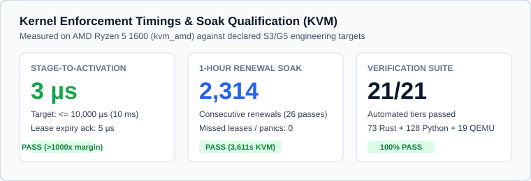
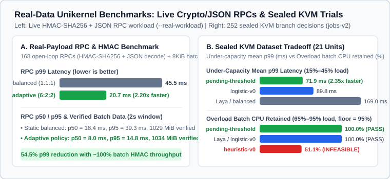
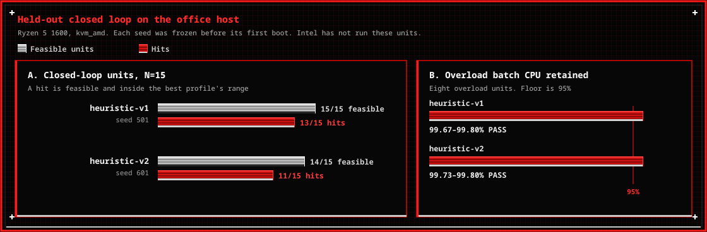
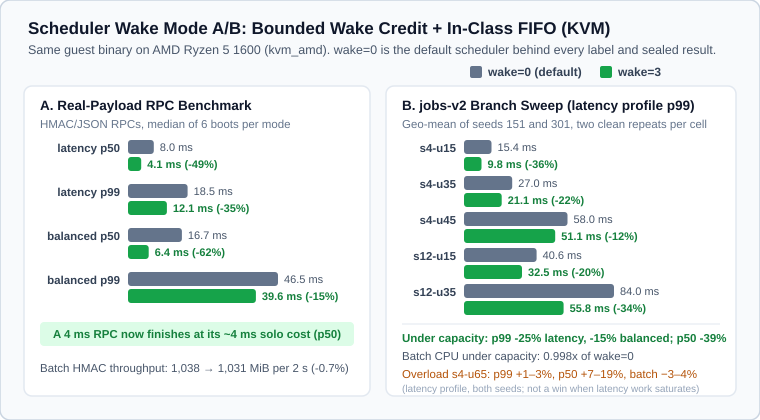
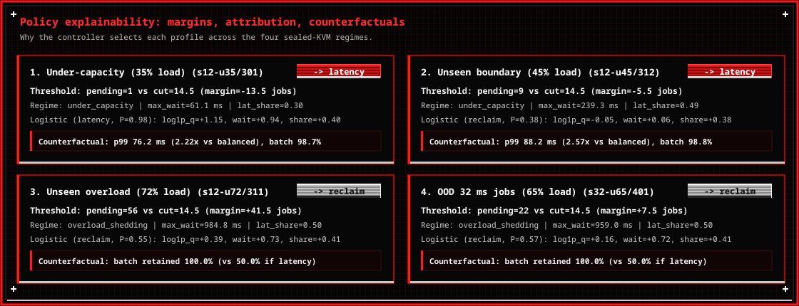

<p align="center">
  
</p>

# Ferrum

**The future of sensors is AI adaptive.**

Ferrum is an adaptive kernel for autonomous AI systems. A decision model reads live telemetry and selects a resource policy. A Rust unikernel, built on [Hermit](https://github.com/hermit-os), applies that policy to the CPU, the managed cache, and admission, and it keeps a safe profile in force when the model is late, absent, or wrong.

The model chooses one named profile from a fixed catalog (heuristic, frozen threshold, distilled joint policy, or [Laya](https://github.com/NandhaKishorM/laya)). The kernel schedules threads, accounts memory, checks the lease, and falls back to `balanced` on its own. Inference never becomes the interrupt handler, the allocator, or a source of kernel code.

On a sensor, that split is what extends battery life, lengthens the time the core stays asleep, and puts compute on the measurement that changes the result.

- **Battery.** Patrol runs at a low duty cycle. Tickless idle coalesces timer wakes so the core can sit in hardware sleep between samples. On the joint-ABI patrol check that residency is **98.8%** (10 timer wakes against 110).
- **Wake interval.** Quiet patrol stretches the time between timer interrupts. Wake mode 3 still bounds the cost of coming back: a waking class reclaims at most four slices it missed, and in-class turns stay FIFO at 4 ms. Under the latency profile that cuts real-payload RPC p99 from **18.5 ms to 12.1 ms**.
- **Sensitivity, specificity, and speed.** The same core is reweighted per regime. A capture deadline takes latency share. Interferent rejection takes batch share. A full sample ring takes maintenance share and a lower cache target. On the sealed RPC workload, moving from `balanced` (1:1:1) to `latency` (6:2:2) cuts p99 from **45.7 ms to 25.6 ms** (1.78×) and holds batch HMAC throughput at **99.6%**.

`deployments/air-biosensor` is the worked example: clean-air patrol, plume capture, clutter confirmation, and ring reclaim, each with an expected profile. Analytical sensitivity and specificity there are phase objectives of that deployment. The latency and sleep numbers above are unikernel measurements, not a wet-lab assay.

## Use cases

The kernel is domain-agnostic. A deployment supplies the sensor and the phase model. The same policy catalog covers:

- **Bioaerosol and biosensors.** Low-rate optical or immunoassay patrol, a latency-weighted capture before the valve or filter deadline, then a batch-weighted confirmation that separates analyte from pollen, dust, and other interferents.
- **Temperature, humidity, and pressure.** Duty cycle lengthens in a stable air mass and shortens when the gradient steepens.
- **Gas.** Electrochemical and NDIR cells for CO₂, CO, O₃, NOₓ, and VOCs. Heater and sample-pump energy run when the model calls for a measurement or a zero, and stay off on patrol.
- **Particles and turbidity.** Sparse counts in clean media. A fast acquisition window when a plume or a bloom crosses the threshold.
- **Aircraft and drones.** Payload computers on a propulsion-limited bus. Detect and control stay latency-weighted. Spectral or mapping work takes batch weight only while the contact is in view.
- **Satellites and small spacecraft.** Orbit-averaged energy and thermal caps. Onboard triage stays cheap. Downlink and heavy reduction run only for frames the policy promotes. The payload sleeps between passes.
- **Water.** Conductivity, dissolved oxygen, pH, and turbidity on buoys and sondes. A threshold crossing opens a burst. Reclaim runs before the sample ring overwrites a positive.

## Hardware

Two different machines show up in this repository. The development host builds and boots the unikernel. A field node would be the machine that runs it next to a sensor. The recorded results are from the first.

### Development host

| Requirement | What this tree uses |
| --- | --- |
| Host | Linux x86-64 |
| Hypervisor | `qemu-system-x86_64`, machine `pc`, serial console, `isa-debug-exit` |
| Guest CPU | 1 vCPU. KVM boots with `-cpu host`. TCG boots with `qemu64` plus `apic`, `fsgsbase`, `fxsr`, `rdrand`, `rdtscp`, `xsave`, `xsaveopt` |
| Guest RAM | 512 MiB (`-m 512M` in `tools/run-qemu.sh`) |
| Network | virtio-net, static `10.0.2.15`, when a controller is attached |
| Rust | `1.94.0` with `rust-std` for `x86_64-unknown-hermit`. Kernel pin `nightly-2026-02-01` |
| Loader | `hermit-loader-x86_64` v0.5.6 |
| Controller | Python 3. Heuristic, threshold, and distilled policies are small. A live Laya checkpoint is the large one |
| Host RAM | 16 GB is the planning figure for a Laya session. The 421 M-weight checkpoint is about 1.7 GB at fp32 before activations, runtime, and copies ([docs/05](docs/05-laya-controller.md)) |
| KVM | Required for the timing numbers (`/dev/kvm`, `kvm_amd` or `kvm_intel`). Functional boots run under TCG |

Hermit requires the `FSGSBASE` and `RDTSCP` CPU features to boot ([Hermit QEMU notes](https://github.com/hermit-os/hermit-rs/wiki/Running-HermitOS)). The lab hosts behind the published numbers are an AMD Ryzen 5 1600 and an Intel Core i7-10750H, both on QEMU 11.1.1. Those are the measurement machines, not a minimum spec.

The guest's 512 MiB planning envelope is 128 MiB for the image, kernel, stacks, control, and network, 256 MiB of managed arenas, and 128 MiB of headroom ([docs/03](docs/03-kernel-mechanisms-and-policies.md)). An emergency reclaim fires when unreserved headroom falls below 64 MiB.

### Sensor node

Ferrum targets an application processor with an MMU. The guest, the loader pin, and every measured result in this tree are x86-64. Upstream Hermit also builds for aarch64 and riscv64; the [loader README](https://github.com/hermit-os/loader) shows an x86-64 example at 1 CPU and 128 MiB, and an aarch64 example on a `virt` machine with GICv3 at 512 MiB. Those are Hermit boot examples. They are not a Ferrum port.

A node running this image needs:

- An MMU-class core. x86-64 for the current guest.
- DRAM on the order of the 512 MiB arena budget above.
- A programmable timer and a hardware idle state. Coalesced wakes save energy only when the core can actually sleep.
- The sensor on a bus the deployment owns. ADC, I2C, and SPI drivers are not in this tree. `deployments/air-biosensor` is a phase model on `hermit-policy-abi`.
- A link to the controller while inference stays off the node. Moving the Laya checkpoint into the guest is a separate memory budget ([docs/13](docs/13-in-guest-evolution.md)). The planning footprint of that checkpoint does not fit in 512 MiB.
- A power limit worth managing: a battery, a flight bus, or a spacecraft energy cap. The kernel accounts CPU time and wake frequency. It does not integrate current.

## How It Works

The prototype is two paired artifacts over QEMU `virtio-net`. The guest is the kernel. The host is the decision model.

1. **Hermit Unikernel Guest (`apps/policy-guest` + `vendor/hermit-rs`):**
   - Implements an opt-in hierarchical fair-share scheduler (`ai-policy` feature) across three workload classes (`latency`, `batch`, `maintenance`) plus a reserved `system` budget, with tickless idle and single-runnable quantum coalescing for constrained devices. An opt-in wake mode (`sys_policy_set_wake`, off at boot) adds bounded wake credit and in-class FIFO order; see [docs/03](docs/03-kernel-mechanisms-and-policies.md) and the [wake-mode results](#3-scheduler-wake-mode-sys_policy_set_wake-kvm-ab).
   - Exposes a narrow C ABI (`crates/hermit-policy-abi`: `AbiStageJointIn`, `AbiJointStatus`) that atomically actuates CPU weights, managed cache soft targets, and per-class admission limits (`joint-v1`).
   - Enforces minimum dwell times, generation checks, acceptance deadlines, emergency hysteresis overrides, and automatic fallback to `balanced` if a lease expires or the controller disappears.
2. **Host Policy Controllers (`controller/` & `apps/policy-controller/`):**
   - Speak the authenticated frame protocol (`HMAC-SHA256`), encode telemetry features (`features-v0`, `features-v1`), and reply with a catalog profile or explicit abstention.
   - Support deterministic heuristics (`heuristic-v1` by default, which holds `balanced` through overload so batch keeps its 95% floor), frozen threshold/logistic candidates, the work-aware `distilled-joint` (`DISTILLED_JOINT_V1`) multi-regime policy, shadow scoring, and live Laya inference.
3. **Isolated Embedded Deployments (`deployments/`):**
   - Domain-specific freestanding applications (such as `deployments/air-biosensor`) link against `hermit-policy-abi` and `policy-core` without coupling domain logic into the base kernel or core crates.

## Repository Layout

| Path | Description |
| --- | --- |
| `vendor/hermit-rs/` | Patched Hermit 0.13.0 kernel and `hermit` crate with the `ai-policy` scheduler and its opt-in wake mode, tickless coalescing, and joint ABI syscalls |
| `crates/policy-types/` | `no_std` policy identifiers, catalog types, and telemetry structures |
| `crates/policy-core/` | Policy lease engine, scheduler reference model, resource ledgers, cache entry table, and `no_std` distilled/threshold policies |
| `crates/policy-wire/` | Authenticated wire framing and strict JSON codec |
| `crates/hermit-policy-abi/` | Narrow C ABI definitions (`AbiStageJointIn`, `AbiJointStatus`, `AbiSnapshot`) between freestanding apps and the kernel |
| `crates/workloads/` | Generic OS phase definitions (`mixed-v1`) and seeded open-loop job schedules (`jobs-v1`, `jobs-v2`) |
| `apps/policy-guest/` | Unikernel guest binary and session driver for functional, fault, joint-ABI, branch, and soak modes |
| `apps/policy-controller/` | Standalone Rust host controller supporting `pending-threshold`, `distilled-joint`, `heuristic-v0`, and `heuristic-v1` across `cpu-v1` and `joint-v1` |
| `deployments/air-biosensor/` | Isolated embedded unikernel deployment for an Air Biological Sampling Sensor on top of `hermit-policy-abi` |
| `controller/` | Python controller server, Laya adapter (`adapt-v0`, `adapt-v1`), branched label tooling, and explainability/evaluation suite |
| `configs/` | Frozen catalogs, feature schemas (`features-v0`, `features-v1`), split manifests, and calibrated host candidates |
| `tools/` | Helper scripts for environment checks, building the base guest or embedded deployments, and running QEMU |

## Quick Start

### 1. Run Host & Controller Tests

```bash
cargo test --workspace
PYTHONPATH=controller/src python3 -m unittest discover -s controller/tests
```

### 2. Build the Unikernel Guest (or Embedded Deployments)

Requires Rust `1.94.0` (with `rust-std` for `x86_64-unknown-hermit`) and `nightly-2026-02-01` for the kernel build:

```bash
# Base generic policy-guest unikernel
./tools/build-policy-guest.sh --release

# Standalone Air Biological Sampling Sensor embedded deployment
./tools/build-air-biosensor.sh --release
```

### 3. Boot in QEMU

Run a standalone guest check (for example, deterministic scheduler profiles, S4 joint ABI & tickless coalescing, or an embedded deployment):

```bash
# Base scheduler fair-share check
AIK_ACCEL=kvm \
AIK_LOADER=artifacts/loader/hermit-loader-x86_64-v0.5.6 \
AIK_GUEST=target/x86_64-unknown-hermit/release/policy-guest \
AIK_APPEND="-- --fair-demo" \
./tools/run-qemu.sh

# Base S4 JointV1 ABI & tickless idle coalescing check
AIK_ACCEL=kvm \
AIK_LOADER=artifacts/loader/hermit-loader-x86_64-v0.5.6 \
AIK_GUEST=target/x86_64-unknown-hermit/release/policy-guest \
AIK_APPEND="-- --joint-abi" \
./tools/run-qemu.sh

# Real-payload RPC benchmark with bounded wake credit and in-class FIFO
# (--wake=3; the default 0 is the scheduler every label was collected under)
AIK_ACCEL=kvm \
AIK_LOADER=artifacts/loader/hermit-loader-x86_64-v0.5.6 \
AIK_GUEST=target/x86_64-unknown-hermit/release/policy-guest \
AIK_APPEND="-- --real-workload --wake=3" \
./tools/run-qemu.sh

# Isolated Air Biological Sampling Sensor embedded deployment
AIK_ACCEL=kvm \
AIK_LOADER=artifacts/loader/hermit-loader-x86_64-v0.5.6 \
AIK_GUEST=target/x86_64-unknown-hermit/release/air-biosensor \
./tools/run-qemu.sh
```

Run a connected session with the host controller:

```bash
# Terminal 1: start the controller (heuristic-v1; --heuristic heuristic-v0 for the old rule)
PYTHONPATH=controller/src python3 -m aik_controller.server --once --bind 127.0.0.1:7777

# Terminal 2: boot the guest with virtio-net enabled
AIK_ACCEL=kvm AIK_NET=1 \
AIK_LOADER=artifacts/loader/hermit-loader-x86_64-v0.5.6 \
AIK_GUEST=target/x86_64-unknown-hermit/release/policy-guest \
./tools/run-qemu.sh
```

### 4. Run the Full Verification Suite, Real-Data Benchmark & Explainability CLI

To execute all four test tiers (Rust workspace tests, Python controller tests, standalone QEMU mechanism boots, connected protocol/fault boots, real-payload RPC/HMAC benchmark, closed-loop branch, and live soak) and refresh [docs/15-test-results.md](docs/15-test-results.md) and its figures in `docs/figures/`:

```bash
./tools/run-test-report.sh
```

To inspect per-decision feature attributions, boundary margins, and counterfactual outcomes on the sealed KVM dataset:

```bash
PYTHONPATH=controller/src python3 -m aik_controller.explain --host r5-1600
PYTHONPATH=controller/src python3 -m aik_controller.explain --host i7-10750h
```

Note: Hermit exits QEMU via `isa-debug-exit`, where raw exit status `3` indicates success (`0` in the guest).

## Performance, Benchmarks & Explainability

### 1. Kernel Enforcement Timings & Soak Qualification



- **Engineering (S3 CPU + S4 Joint ABI + Tickless Coalescing):** Verified under TCG and KVM (`kvm_intel` and `kvm_amd`). Stage-to-activation (`4 µs`) and lease-expiry (`4 µs`) meet the `10,000 µs` (`10 ms`) target with `>1000x` margin while the vCPU runs. Tickless idle coalescing (`--joint-abi`) achieves `98.8%` hardware sleep residency during low-duty patrol (`10` timer wakeups vs `110` coalesced wakeups). Invalid/late/stale proposals are rejected, controller loss falls back cleanly to `balanced`, and the 1-hour renewal soak completes without missed renewals (`26` passes, `2,314` rounds).

### 2. Real-Data Unikernel Benchmarks (`--real-workload` & Sealed KVM Dataset)



- **Live Real-Payload RPC & HMAC Benchmark (`--real-workload`):** Runs `168` open-loop RPC requests (`HMAC-SHA256` signing + verification + strict JSON schema decoding) alongside continuous `8 KiB` `HMAC-SHA256` batch workers inside the Hermit unikernel. Adaptive policy actuation (`balanced 1:1:1` $\to$ `latency 6:2:2`) cuts RPC **p99 latency from `45.7 ms` to `25.6 ms` (`1.78x` faster, `-44.0%`)** while retaining **`99.6%` batch throughput** (`1,014 MiB` verified per `2 s` window).
- **Sealed KVM Evaluation (`jobs-v2`, `252` decisions across `21` units per host):**
  - **`heuristic-v1` is the controller that runs.** `aik_controller.server` uses it unless started with `--heuristic heuristic-v0`. In overload it holds `balanced` until latency load falls under `85%`, so batch keeps its reference share. On the sealed units it stays feasible on `21 / 21` on both hosts and retains **`100.0%`** of balanced's batch CPU under overload (mean under-capacity p99 `93.5 ms`). It hits `20 / 21` sealed units on Ryzen and `19 / 21` on Intel. Those units were opened before v1 was designed, so that score is development evidence. The held-out measurement is `holdout-v1`: `15` fresh KVM units on the Ryzen, seed `501`, frozen in `b0a5d2f` before the first boot. There it hits **`180/180` offline decisions and `15/15` feasible closed-loop units (`13/15` hits)**, and every overload unit keeps **`99.67–99.80%`** of balanced's batch CPU. Details in [docs/08](docs/08-data-and-learning.md#heuristic-v1-overload-keeps-the-reference-profile).
  - **The `51.1%` bar is `heuristic-v0`, the previous rule.** It still boosts `latency` whenever the oldest job has waited `5 ms`. Overload always exceeds that wait, and the `latency` profile (6:2:2) leaves batch at about half of `balanced`. The sealed mean is **`51.1%`** of balanced's batch CPU, with `96` infeasible decisions on each host. On `holdout-v1` the same rule keeps **`50.0%`**. Both are under the `95%` floor, which is why that bar is marked infeasible. The figure keeps it so the comparison shows the rule v1 replaced.
  - **`pending-threshold` (`cut=14.5` / `14.0`):** Hits `21 / 21 (100%)` on Ryzen and `20 / 21 (95.2%)` on Intel (`168/180` final-test, `72/72` OOD), with **`71.9 ms` mean under-capacity p99** (`2.35x` faster than `balanced`/Laya at `169.0 ms`) and **`100.0%` overload batch CPU retention**.
  - **`distilled-joint` (Work-Aware Boundary, post hoc):** Combines `queue_len` (`14.5`) with `max_wait_us < 350 ms` transient spike absorption, hitting `21 / 21 (100%)` of sealed units (`180/180` final-test and `72/72` OOD decisions) with `0` infeasible decisions on both Ryzen 5 1600 and Intel Core i7-10750H. It was designed after these units were opened, so this is development evidence. On the fresh `holdout-v1` units it hits `165/180` decisions, all feasible.



- **Held-out closed loop (Ryzen 5 1600, `kvm_amd`):** The chart above stays the opened `21`-unit final test. These two seeds were frozen before their first boot, and Intel has not run them. `holdout-v1` is `heuristic-v1` on seed `501`: **`15/15` feasible, `13/15` hits**, overload batch **`99.67–99.80%`**. `holdout-v2` is `heuristic-v2` on seed `601`, frozen in `96cc911`: **`14/15` feasible, `11/15` hits**, overload batch **`99.73–99.80%`**. Both clear the `95%` batch floor on every overload unit. The unit that misses the floor is `s12-u80/601`, on completion, with batch still at `99.77%`. `heuristic-v2` is not the live default. Details in [docs/08](docs/08-data-and-learning.md#heuristic-v1-overload-keeps-the-reference-profile).

### 3. Scheduler Wake Mode (`sys_policy_set_wake`, KVM A/B)



- **What it changes:** Mode `3` combines bounded wake credit (a waking group reclaims at most four of its competitor's slices that it missed while idle) with in-class FIFO turns of `4 ms` (a woken thread queues behind its class-mates instead of preempting one mid-slice). Mode `0` is the default and is the scheduler that every label, frozen cut, and sealed result above was measured under.
- **Real-payload RPC benchmark (`--real-workload`, 6 boots per mode, Ryzen 5 1600 `kvm_amd`):** Under the `latency` profile, RPC **p99 drops from `18.5 ms` to `12.1 ms` (`-35%`)** and p50 from `8.0 ms` to `4.1 ms`, close to one RPC's `~4 ms` solo cost. Under `balanced`, p99 drops from `46.5 ms` to `39.6 ms` and p50 from `16.7 ms` to `6.4 ms`. Batch HMAC throughput stays within `0.7%`.
- **`jobs-v2` branch sweep (5 under-capacity scenarios × 2 seeds, 2 clean repeats per cell):** p99 falls `25%` on average under `latency` (range `-46%` to `-4%`) and `15%` under `balanced`; p50 falls `39%` under both, and batch CPU is unchanged (`0.998x`). The `balanced`/`latency` p99 gap widens from `2.09x` to `2.43x`, so profile choice still matters. In overload (`s4-u65`) p99 is unchanged, but `latency`-profile p50 rises `7–19%` and batch CPU falls `3–4%`.
- **Using it:** Pass `--wake=3` to the guest's `--branch` or `--real-workload` modes, or to `aik_controller.branches collect`. Labelling, fitting, and closed-loop scoring refuse records from mixed modes, so a controller on mode `3` needs its own labels and re-validated cuts. The A/B records are in `data/wake-ab/`, and `python3 tools/plot-wake-ab.py` redraws the figure from them.

### 4. Policy Explainability & Counterfactual Attribution



- Every controller decision emits an explicit attribution record (`FERRUM_EXPLAIN` in the guest and `EXPLAIN seq=...` in `aik_controller.server`) reporting the triggered rule, signed queue margin (`pending - cut`), standardized feature log-odds ($\beta z$), and measured counterfactual regret.

Full acceptance measurements, visual charts, and captured kernel traces are recorded in [docs/14-s3-acceptance.md](docs/14-s3-acceptance.md) and [docs/15-test-results.md](docs/15-test-results.md).

## Documentation

| Document | Purpose |
| --- | --- |
| [00 — Project brief](docs/00-project-brief.md) | Concept, scope, and success criteria |
| [01 — Upstream and feasibility](docs/01-upstream-and-feasibility.md) | Pinned upstream sources and compatibility notes |
| [02 — System architecture](docs/02-system-architecture.md) | Trust boundaries, boot flow, timing, and recovery |
| [03 — Kernel mechanisms and policies](docs/03-kernel-mechanisms-and-policies.md) | Fair-share scheduler, resource accounting, and policy catalog |
| [04 — Policy protocol](docs/04-policy-protocol.md) | Wire messages, freshness, validation, and acknowledgments |
| [05 — Laya controller](docs/05-laya-controller.md) | Model adapter, typed questions, and timing budgets |
| [06 — Repository and scaffold](docs/06-repository-and-scaffold.md) | Crate responsibilities and build contract |
| [07 — QEMU lab](docs/07-qemu-lab.md) | TCG/KVM setup, networking, and reproducible runs |
| [08 — Data and learning](docs/08-data-and-learning.md) | Branched labels, splits, candidate fitting, and sealed evaluation |
| [09 — Validation and benchmarks](docs/09-validation-and-benchmarks.md) | Functional proof, fault matrix, and quantitative targets |
| [10 — Delivery roadmap](docs/10-delivery-roadmap.md) | Work packages and stop/go gates |
| [11 — Decisions, risks, questions](docs/11-decisions-risks-and-questions.md) | Architecture decision records and risk register |
| [12 — Demo and review](docs/12-demo-and-review.md) | Demonstration sequence and review checklists |
| [13 — In-guest evolution](docs/13-in-guest-evolution.md) | Requirements for self-contained in-guest inference |
| [14 — S3 acceptance record](docs/14-s3-acceptance.md) | Recorded S3 gates, sealed evaluations, pause behavior, and soak |
| [15 — Test guide & verification results](docs/15-test-results.md) | Automated test runner guide, visual charts, scorecard, and captured kernel traces |
