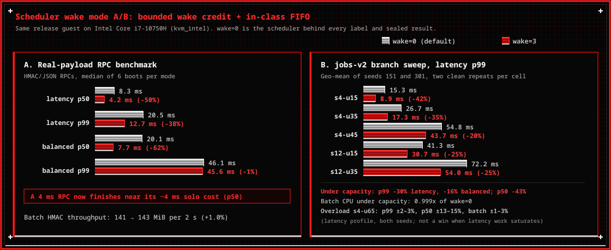

<p align="center">
  
</p>

# Ferrum

**The future of sensors is AI adaptive.**

Ferrum is an adaptive kernel for autonomous sensor systems. A decision model reads live telemetry and picks one named profile from a fixed catalog (heuristic, frozen threshold, distilled joint policy, or [Laya](https://github.com/NandhaKishorM/laya)). A Rust unikernel on [Hermit](https://github.com/hermit-os) applies that profile to CPU, managed cache, and admission, and falls back to `balanced` when the model is late, absent, or wrong. Inference stays out of the interrupt handler, the allocator, and kernel code.

On a sensor that split is sleep time and compute aimed at the measurement that matters:

- **Battery.** Tickless idle on the joint-ABI patrol check: **98.8%** hardware sleep (`10` timer wakes against `110` coalesced).
- **Wake.** Mode `3` (off at boot) gives a waking class at most four missed slices and `4 ms` in-class FIFO turns. Latency-profile RPC p99 falls from **`18.5 ms` to `12.1 ms`**.
- **Speed.** Sealed RPC, `balanced` (1:1:1) to `latency` (6:2:2): p99 **`45.7 ms` to `25.6 ms`** (`1.78x`) at **`99.6%`** batch HMAC.

`deployments/air-biosensor` is the worked example: patrol, capture, confirmation, reclaim. Sensitivity and specificity there are phase objectives. The numbers above are unikernel measurements.

## Use cases

The kernel is domain-agnostic. A deployment supplies the sensor and the phase model. The same catalog covers bioaerosol and immunoassay patrol, weather duty-cycling, electrochemical and NDIR gas cells, particle and turbidity bursts, aircraft and drone payloads, orbit-averaged spacecraft triage, and buoy or sonde water sampling.

## Hardware

The development host builds and boots the unikernel. A field node would run it next to a sensor. Every recorded result is from the first.

### Development host

| Requirement | What this tree uses |
| --- | --- |
| Host | Linux x86-64 |
| Hypervisor | `qemu-system-x86_64`, machine `pc`, serial console, `isa-debug-exit` |
| Guest CPU | 1 vCPU. KVM: `-cpu host`. TCG: `qemu64` plus `apic`, `fsgsbase`, `fxsr`, `rdrand`, `rdtscp`, `xsave`, `xsaveopt` |
| Guest RAM | 512 MiB (`-m 512M` in `tools/run-qemu.sh`) |
| Network | virtio-net, static `10.0.2.15`, when a controller is attached |
| Rust | `1.94.0` with `rust-std` for `x86_64-unknown-hermit`. Kernel pin `nightly-2026-02-01` |
| Loader | `hermit-loader-x86_64` v0.5.6 |
| Controller | Python 3. Heuristic, threshold, and distilled policies are small. A live Laya checkpoint is the large one |
| Host RAM | 16 GB planning figure for a Laya session. The 421 M-weight checkpoint is about 1.7 GB at fp32 before activations, runtime, and copies ([docs/05](docs/05-laya-controller.md)) |
| KVM | Required for the timing numbers (`/dev/kvm`, `kvm_amd` or `kvm_intel`). Functional boots run under TCG |

Hermit requires `FSGSBASE` and `RDTSCP` ([Hermit QEMU notes](https://github.com/hermit-os/hermit-rs/wiki/Running-HermitOS)). Published numbers are from an AMD Ryzen 5 1600 and an Intel Core i7-10750H, both on QEMU 11.1.1. The 512 MiB guest budget is 128 MiB image and kernel, 256 MiB arenas, 128 MiB headroom. Emergency reclaim fires below 64 MiB of unreserved headroom ([docs/03](docs/03-kernel-mechanisms-and-policies.md)).

### Sensor node

This image is x86-64. Upstream Hermit also builds aarch64 and riscv64; the [loader README](https://github.com/hermit-os/loader) shows those as boot examples, not a Ferrum port.

- An MMU-class x86-64 core, and DRAM on the 512 MiB budget above.
- A programmable timer and a hardware idle state, so coalesced wakes can become sleep.
- The sensor bus in the deployment. ADC, I2C, and SPI are not in this tree. `deployments/air-biosensor` is a phase model on `hermit-policy-abi`.
- A link to the controller while inference stays off the node. That Laya checkpoint does not fit in 512 MiB ([docs/13](docs/13-in-guest-evolution.md)).
- A battery, flight bus, or spacecraft energy cap. The kernel accounts CPU time and wake frequency, not current.

## How It Works

Two artifacts over QEMU `virtio-net`. The guest is the kernel. The host is the decision model.

1. **Guest (`apps/policy-guest`, `vendor/hermit-rs`).** Opt-in fair-share scheduler (`ai-policy`) across `latency`, `batch`, and `maintenance`, plus a reserved `system` budget; tickless idle; opt-in wake mode (`sys_policy_set_wake`, off at boot). See [docs/03](docs/03-kernel-mechanisms-and-policies.md) and the [wake-mode results](#3-scheduler-wake-mode-sys_policy_set_wake-kvm-ab). Narrow C ABI (`crates/hermit-policy-abi`) stages CPU weights, cache targets, and admission together (`joint-v1`). Dwell, generation, and deadline checks. Lease expiry or controller loss falls back to `balanced`.
2. **Host (`controller/`, `apps/policy-controller/`).** Authenticated frames (`HMAC-SHA256`), feature encoders (`features-v0`, `features-v1`), and a catalog profile or an abstention. Live default is `heuristic-v1`, which holds `balanced` through overload so batch keeps its 95% floor. Also frozen threshold and logistic candidates, `distilled-joint`, shadow scoring, and live Laya.
3. **Deployments (`deployments/`).** Freestanding apps such as `air-biosensor` link `hermit-policy-abi` and `policy-core`. Domain logic stays out of the kernel.

## Repository Layout

| Path | Description |
| --- | --- |
| `vendor/hermit-rs/` | Patched Hermit 0.13.0: `ai-policy` scheduler, wake mode, tickless coalescing, joint ABI |
| `crates/policy-types/` | `no_std` identifiers, catalog types, telemetry |
| `crates/policy-core/` | Lease engine, scheduler model, ledgers, cache table, distilled and threshold policies |
| `crates/policy-wire/` | Authenticated framing and strict JSON |
| `crates/hermit-policy-abi/` | C ABI (`AbiStageJointIn`, `AbiJointStatus`, `AbiSnapshot`) |
| `crates/workloads/` | Phase definitions (`mixed-v1`) and open-loop schedules (`jobs-v1`, `jobs-v2`) |
| `apps/policy-guest/` | Unikernel guest: functional, fault, joint-ABI, branch, and soak modes |
| `apps/policy-controller/` | Rust host controller: `pending-threshold`, `distilled-joint`, `heuristic-v0`, `heuristic-v1` |
| `deployments/air-biosensor/` | Air Biological Sampling Sensor on `hermit-policy-abi` |
| `controller/` | Python server, Laya adapters, branch labels, explainability |
| `configs/` | Catalogs, feature schemas, split manifests, host candidates |
| `tools/` | Environment checks, guest and deployment builds, QEMU |

## Quick Start

### 1. Run Host & Controller Tests

```bash
cargo test --workspace
PYTHONPATH=controller/src python3 -m unittest discover -s controller/tests
```

### 2. Build the Unikernel Guest (or Embedded Deployments)

Rust `1.94.0` (`rust-std` for `x86_64-unknown-hermit`) and `nightly-2026-02-01` for the kernel:

```bash
./tools/build-policy-guest.sh --release
./tools/build-air-biosensor.sh --release
```

### 3. Boot in QEMU

Hermit reports success as `isa-debug-exit` raw status `3` (`0` in the guest).

```bash
# Fair-share check
AIK_ACCEL=kvm \
AIK_LOADER=artifacts/loader/hermit-loader-x86_64-v0.5.6 \
AIK_GUEST=target/x86_64-unknown-hermit/release/policy-guest \
AIK_APPEND="-- --fair-demo" \
./tools/run-qemu.sh

# Joint ABI and tickless idle
AIK_ACCEL=kvm \
AIK_LOADER=artifacts/loader/hermit-loader-x86_64-v0.5.6 \
AIK_GUEST=target/x86_64-unknown-hermit/release/policy-guest \
AIK_APPEND="-- --joint-abi" \
./tools/run-qemu.sh

# Real-payload RPC with wake mode 3 (mode 0 is the scheduler behind the labels)
AIK_ACCEL=kvm \
AIK_LOADER=artifacts/loader/hermit-loader-x86_64-v0.5.6 \
AIK_GUEST=target/x86_64-unknown-hermit/release/policy-guest \
AIK_APPEND="-- --real-workload --wake=3" \
./tools/run-qemu.sh

# Air Biological Sampling Sensor
AIK_ACCEL=kvm \
AIK_LOADER=artifacts/loader/hermit-loader-x86_64-v0.5.6 \
AIK_GUEST=target/x86_64-unknown-hermit/release/air-biosensor \
./tools/run-qemu.sh
```

Connected session. `heuristic-v1` is the default; `--heuristic heuristic-v0` restores the previous rule.

```bash
# Terminal 1
PYTHONPATH=controller/src python3 -m aik_controller.server --once --bind 127.0.0.1:7777

# Terminal 2
AIK_ACCEL=kvm AIK_NET=1 \
AIK_LOADER=artifacts/loader/hermit-loader-x86_64-v0.5.6 \
AIK_GUEST=target/x86_64-unknown-hermit/release/policy-guest \
./tools/run-qemu.sh
```

### 4. Full Verification, Real-Data Benchmark & Explainability

Rust tests, Python tests, QEMU mechanism and fault boots, the RPC/HMAC benchmark, a closed-loop branch, and the live soak. Refreshes [docs/15-test-results.md](docs/15-test-results.md) and `docs/figures/`.

```bash
./tools/run-test-report.sh
```

```bash
PYTHONPATH=controller/src python3 -m aik_controller.explain --host r5-1600
PYTHONPATH=controller/src python3 -m aik_controller.explain --host i7-10750h
```

## Performance, Benchmarks & Explainability

### 1. Kernel Enforcement Timings & Soak Qualification


Verified under TCG and KVM (`kvm_intel` and `kvm_amd`). Stage-to-activation and lease-expiry are both **`4 µs`** against a **`10 ms`** target (`>1000x`) while the vCPU runs. Tickless idle (`--joint-abi`) holds **`98.8%`** hardware sleep on low-duty patrol (`10` timer wakes vs `110` coalesced). Invalid, late, and stale proposals are rejected. Controller loss falls back to `balanced`. The 1-hour renewal soak missed none: **`26` passes, `2,314` rounds**.

### 2. Real-Data Unikernel Benchmarks (`--real-workload` & Sealed KVM Dataset)


- **Live RPC and HMAC (`--real-workload`).** `168` open-loop `HMAC-SHA256` RPCs (sign, verify, strict JSON) beside continuous `8 KiB` HMAC batch workers. `balanced` (1:1:1) to `latency` (6:2:2) cuts p99 from **`45.7 ms` to `25.6 ms`** (`1.78x`, `-44.0%`) at **`99.6%`** batch throughput (`1,014 MiB` per `2 s`).
- **Sealed KVM (`jobs-v2`, `252` decisions, `21` units per host).**
  - **`heuristic-v1` runs.** `aik_controller.server` uses it unless passed `--heuristic heuristic-v0`. In overload it holds `balanced` until latency load falls under `85%`. Feasible on **`21/21`** both hosts, **`100.0%`** overload batch CPU, mean under-capacity p99 **`93.5 ms`**. Hits **`20/21`** Ryzen and **`19/21`** Intel. Those units were opened before v1, so this is development evidence. On Ryzen `holdout-v1` (seed `501`, frozen in `b0a5d2f`) it hits **`180/180`** offline. Closed loop is the chart below. [docs/08](docs/08-data-and-learning.md#heuristic-v1-overload-keeps-the-reference-profile).
  - **`heuristic-v0` is the `51.1%` bar.** It boosts `latency` once the oldest job has waited `5 ms`, so overload leaves batch near half of `balanced`: sealed mean **`51.1%`**, **`96`** infeasible decisions per host, **`50.0%`** on `holdout-v1`. Both sit under the `95%` floor, which is why the bar is marked infeasible.
  - **`pending-threshold` (`cut=14.5` / `14.0`).** **`21/21`** Ryzen, **`20/21`** Intel (`168/180` final-test, `72/72` OOD). Mean under-capacity p99 **`71.9 ms`** (`2.35x` vs `balanced`/Laya at `169.0 ms`). Overload batch **`100.0%`**.
  - **`distilled-joint` (post hoc).** `queue_len` `14.5` and `max_wait_us < 350 ms`. **`21/21`** sealed units (`180/180` final-test, `72/72` OOD), **`0`** infeasible on both hosts. Designed after these units opened, so this is development evidence. On `holdout-v1` it hits **`165/180`**, all feasible.


Seeds `501` and `601` were frozen before their first boot. This figure is the held-out closed loop. The figure at the start of this section is the opened `21`-unit final test. Every overload unit clears the `95%` batch floor. `heuristic-v2` is not the live default.

| Host | Rule | Seed | Feasible | Hits | Overload batch |
| --- | --- | --- | --- | --- | --- |
| Ryzen 5 1600 | `heuristic-v1` | `501` | `15/15` | `13/15` | `99.67–99.80%` |
| i7-10750H | `heuristic-v1` | `501` | `14` scored (`s4-u45/501` diverged) | `12/14` | `99.83–99.87%` |
| Ryzen 5 1600 | `heuristic-v2` | `601` | `14/15` | `11/15` | `99.73–99.80%` |
| i7-10750H | `heuristic-v2` | `601` | `15/15` | `13/15` | `99.84–99.90%` |

The Ryzen v2 miss is `s12-u80/601`, on completion, with batch still at `99.77%`. `holdout-v2` was frozen in `96cc911`. Detail in [docs/08](docs/08-data-and-learning.md#heuristic-v1-overload-keeps-the-reference-profile).

### 3. Scheduler Wake Mode (`sys_policy_set_wake`, KVM A/B)




Mode `3` is bounded wake credit (at most four missed slices) plus `4 ms` in-class FIFO. Mode `0` is the default and the scheduler behind the labels, cuts, and sealed results above.

- **RPC (`--real-workload`, 6 boots per mode, release guest).** Ryzen, `latency`: p99 **`18.5 ms` to `12.1 ms` (`-35%`)**, p50 `8.0 ms` to `4.1 ms` (about one RPC's `~4 ms` solo cost). `balanced`: p99 `46.5 ms` to `39.6 ms`, p50 `16.7 ms` to `6.4 ms`. Batch HMAC within `0.7%`. Intel, `latency`: p99 **`20.5 ms` to `12.7 ms` (`-38%`)**, p50 `8.3 ms` to `4.2 ms`. `balanced`: p99 `46.1 ms` to `45.6 ms`, p50 `20.1 ms` to `7.7 ms`. Batch within `1.0%` (`141.3` to `142.8 MiB` per `2 s` under `latency`).
- **`jobs-v2` sweep** (5 under-capacity scenarios × 2 seeds × 2 clean repeats). Under-capacity batch CPU stays flat. The `balanced`/`latency` p99 gap widens, so profile choice still matters.

| Host | Latency p99 | Balanced p99 | p50 | Batch CPU | p99 gap | Overload `s4-u65` |
| --- | --- | --- | --- | --- | --- | --- |
| Ryzen | `-25%` (`-46%` to `-4%`) | `-15%` | `-39%` | `0.998x` | `2.09x` to `2.43x` | p99 flat; `latency` p50 `+7–19%`; batch `-3–4%` |
| Intel | `-30%` | `-16%` | `-43%` | `0.999x` | `2.07x` to `2.48x` | p99 `±2–3%`; p50 `±13–15%`; batch `±1–3%` |

- **Development labels, wake mode `3`, Ryzen, seed `151`.** 8 units, 97 boots, 96 clean branches, 1 disturbed. Seven labels match the mode-`0` run. `s12-u65` moved from a {balanced, reclaim} tie to `balanced` alone. Pending jobs stayed `0–3` under an even split and `18–292` over it. Frozen `heuristic-v1` and `heuristic-v2` each hit **`96/96`**, none infeasible. The seed was already open under mode `0`, so this re-checks those cuts. Mode `3` stays off at boot. Records: `data/jobs-v2/development-seed151-r5-1600-wake3.jsonl`, labels: `data/jobs-v2/labels-development-seed151-r5-1600-wake3.json`.
- **Using it.** `--wake=3` on `--branch`, `--real-workload`, or `aik_controller.branches collect`. Label, fit, and closed-loop scoring refuse mixed modes. A/B records are in `data/wake-ab/`. `python3 tools/collect-wake-ab.py` collects this host; `python3 tools/plot-wake-ab.py` redraws the figures.

### 4. Policy Explainability & Counterfactual Attribution


Each decision emits `FERRUM_EXPLAIN` in the guest and `EXPLAIN seq=...` in `aik_controller.server`: the rule, the signed queue margin (`pending - cut`), standardized log-odds ($\beta z$), and measured counterfactual regret.

Acceptance measurements, charts, and kernel traces: [docs/14-s3-acceptance.md](docs/14-s3-acceptance.md), [docs/15-test-results.md](docs/15-test-results.md).

## Documentation

| Document | Purpose |
| --- | --- |
| [00 — Project brief](docs/00-project-brief.md) | Concept, scope, and success criteria |
| [01 — Upstream and feasibility](docs/01-upstream-and-feasibility.md) | Pinned upstream sources and compatibility notes |
| [02 — System architecture](docs/02-system-architecture.md) | Trust boundaries, boot flow, timing, and recovery |
| [03 — Kernel mechanisms and policies](docs/03-kernel-mechanisms-and-policies.md) | Fair-share scheduler, resource accounting, and policy catalog |
| [04 — Policy protocol](docs/04-policy-protocol.md) | Wire messages, freshness, validation, and acknowledgments |
| [05 — Laya controller](docs/05-laya-controller.md) | Model adapter, typed questions, and timing budgets |
| [06 — Repository and scaffold](docs/06-repository-and-scaffold.md) | Crate responsibilities and build contract |
| [07 — QEMU lab](docs/07-qemu-lab.md) | TCG/KVM setup, networking, and reproducible runs |
| [08 — Data and learning](docs/08-data-and-learning.md) | Branched labels, splits, candidate fitting, and sealed evaluation |
| [09 — Validation and benchmarks](docs/09-validation-and-benchmarks.md) | Functional proof, fault matrix, and quantitative targets |
| [10 — Delivery roadmap](docs/10-delivery-roadmap.md) | Work packages and stop/go gates |
| [11 — Decisions, risks, questions](docs/11-decisions-risks-and-questions.md) | Architecture decision records and risk register |
| [12 — Demo and review](docs/12-demo-and-review.md) | Demonstration sequence and review checklists |
| [13 — In-guest evolution](docs/13-in-guest-evolution.md) | Requirements for self-contained in-guest inference |
| [14 — S3 acceptance record](docs/14-s3-acceptance.md) | Recorded S3 gates, sealed evaluations, pause behavior, and soak |
| [15 — Test guide & verification results](docs/15-test-results.md) | Automated test runner guide, visual charts, scorecard, and captured kernel traces |
