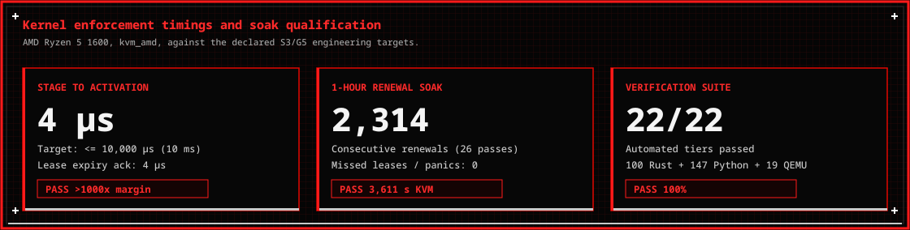
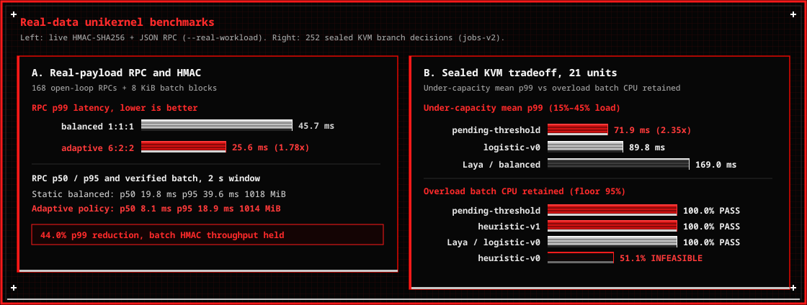
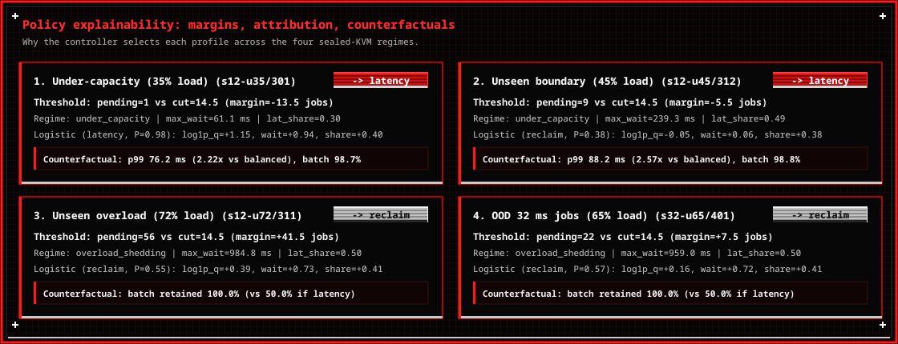
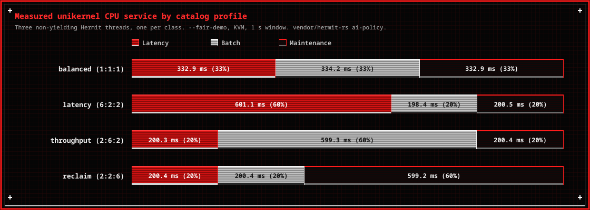
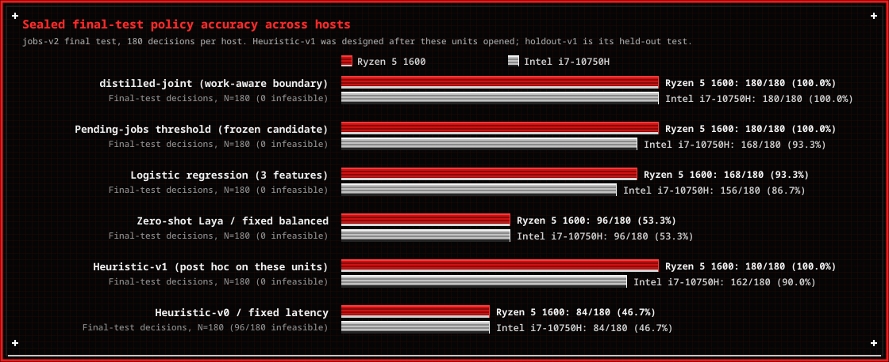
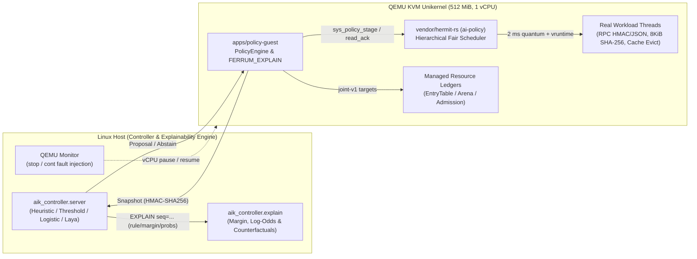

# Test Guide, Real-Data Benchmarks & Policy Explainability

This document shows how to run Ferrum's automated verification suite, benchmarks the unikernel on real cryptographic/JSON workloads and 1,750+ recorded KVM trials, and explains how and why each policy decision is made.

## 1. How to Run the Tests & Explainability CLI

### One-Command Full Verification & Report Generation

To run all four test tiers (Rust workspace tests, Python controller tests, standalone QEMU unikernel mechanism boots, connected controller/fault matrix boots, real-payload RPC/HMAC benchmark, closed-loop branch, and renewal soak) and regenerate this document and its figures:

```bash
./tools/run-test-report.sh
```

### Run the Policy Explainability & Counterfactual Analyzer

```bash
PYTHONPATH=controller/src python3 -m aik_controller.explain --host r5-1600
PYTHONPATH=controller/src python3 -m aik_controller.explain --host i7-10750h
```

### Run the Real-Payload Unikernel Benchmark (`--real-workload`)

```bash
AIK_ACCEL=kvm \
AIK_LOADER=artifacts/loader/hermit-loader-x86_64-v0.5.6 \
AIK_GUEST=target/x86_64-unknown-hermit/release/policy-guest \
AIK_APPEND="-- --real-workload" \
./tools/run-qemu.sh
```

---

## 2. Visual Overview

### Executive Summary & Timings



### Real-Data Benchmarks: Live RPC/HMAC Unikernel Workload & Sealed KVM Trials



### Policy Explainability: Boundary Margins, Feature Attribution & Counterfactuals



### Measured CPU Service Shares by Catalog Profile (`--fair-demo`)



### Sealed Final-Test Policy Accuracy Across Hosts (`jobs-v2`)



### System & Explainable Control Architecture



---

## 3. Real-Data Benchmark Analysis & Explainability

### 3.1 Live Real-Payload Unikernel Benchmark (`--real-workload`)

Instead of synthetic spin loops, `--real-workload` executes real cryptographic and parser operations across the unikernel's workload classes:
- **Latency class (3 threads):** Open-loop schedule (`s4-u35`, 168 RPC requests over 2.0 s). Each request performs `206` cycles of `policy_wire::seal` (HMAC-SHA256 signing), `policy_wire::open` (constant-time MAC verification), and `policy_wire::decode_message` (strict schema-validated JSON parsing).
- **Batch class (3 threads):** Continuously seals and verifies 8 KiB data blocks with HMAC-SHA256 (`~1.02 GiB` verified per 2-second window).

| Mode | Active Profile | Offered / Completed RPCs | RPC p50 | RPC p95 | RPC p99 | Verified Batch Data (2 s) | Batch Retention |
| --- | --- | --- | --- | --- | --- | --- | --- |
| **Static Baseline** | `balanced (1:1:1)` | `168 / 168 (100%)` | `19.80 ms` | `39.63 ms` | **`45.75 ms`** | `1018 MiB` (`130375` blocks) | `100.0%` |
| **Adaptive Policy** | `latency (6:2:2)` | `168 / 168 (100%)` | `8.11 ms` | `18.95 ms` | **`25.63 ms`** | `1014 MiB` (`129802` blocks) | **`99.6%`** |

**Why it works (`FERRUM_EXPLAIN`):** Because offered RPC work is ~34% of one vCPU (`~670 ms` out of `2,000 ms`), `pending` stays below the `14.5` overload cut (`margin = -14.5 jobs`, `regime = under_capacity`). Switching from `1:1:1` to `6:2:2` gives arriving RPC threads 75% share while active so they finish in fewer 2 ms quanta (**cutting p99 latency by 44.0%, or 1.78x faster**), and because the fair scheduler is work-conserving, batch threads immediately reclaim all unused slices (`~1,320 ms` of the 2,000 ms window).

### 3.2 Sealed Real-Data KVM Benchmark Across Controllers (`jobs-v2`)

Across all **21 sealed evaluation units** (252 individual QEMU KVM boots on Ryzen 5 1600 covering 15 `final_test` units and 6 `out_of_distribution` units):

| Controller | Sealed Units Hit (Ryzen / Intel) | Feasible Units (>=95% Batch & Completion) | Under-Capacity Mean p99 (15%–45% Load) | Overload Mean Batch CPU Retained (65%–95% Load) | Primary Failure Mode Explained |
| --- | --- | --- | --- | --- | --- |
| **`distilled-joint` (Work-Aware Boundary, post hoc)** | **`21 / 21 (100.0%)` / `21 / 21 (100.0%)`** | **`21 / 21 (100.0%)` / `21 / 21 (100.0%)`** | **`71.88 ms`** | **`100.00%`** | None across both hosts; combines `queue_len` (`14.5`) with `max_wait_us < 350 ms` transient spike absorption. Designed on Oct 23, after these units were opened, so this row is not a held-out score. |
| **`pending-threshold` (`cut=14.5` / `14.0`)** | **`21 / 21 (100.0%)` / `20 / 21 (95.2%)`** | **`21 / 21 (100.0%)` / `21 / 21 (100.0%)`** | **`71.88 ms`** | **`100.00%`** | Boundary is `pending` count alone; transient queue spike (`pending=17`, `wait=357ms`) on Intel `s12-u45/312` triggers shed. |
| **`logistic-v0` (3 features)** | `20 / 21 (95.2%)` / `19 / 21 (90.5%)` | `21 / 21 (100.0%)` / `21 / 21 (100.0%)` | `89.83 ms` | `100.00%` | At unseen 45% load (`s12-u45`), `latency_share=0.49` tips log-odds toward `reclaim`, losing 2.57x p99 speedup. |
| **Zero-Shot Laya / `fixed-balanced`** | `12 / 21 (57.1%)` / `11 / 21 (52.4%)` | `21 / 21 (100.0%)` / `21 / 21 (100.0%)` | `169.01 ms` | `100.00%` | Always selects `balanced`; misses every under-capacity opportunity to cut tail latency by 2.2x–3.8x. |
| **`heuristic-v0` / `fixed-latency`** | `9 / 21 (42.9%)` / `9 / 21 (42.9%)` | `9 / 21 (42.9%)` / `9 / 21 (42.9%)` | `71.88 ms` | `51.07%` (violates 95% floor) | Triggers on `max_wait_us >= 5 ms` even during overload, starving batch CPU down to ~51%. |
| **`heuristic-v1` (overload regime, post hoc)** | `20 / 21 (95.2%)` / `19 / 21 (90.5%)` | `21 / 21 (100.0%)` / `21 / 21 (100.0%)` | `93.46 ms` | `100.00%` | Keeps the reference profile once latency fills its reference share with a stalled backlog or a boost cuts batch under 95%, and holds it until latency load drops under 85%. Bursty 32 ms jobs (`s32-u35`) look stalled and get `balanced`. Designed after these units were opened; its held-out test is `holdout-v1`. |

### 3.3 Decision Explainability & Counterfactual Case Studies

| Unit (`split`) | Pending Jobs (Margin to Cut `14.5`) | Max Wait / Latency Share | `pending-threshold` Rationale | `logistic-v0` Attribution ($eta z$) | `heuristic-v0` Rule | Measured Counterfactual Outcome |
| --- | --- | --- | --- | --- | --- | --- |
| `s12-u35/301` (final_test) | `1` (margin `-13.5`) | `61.1 ms` / `0.30` | **`latency`** (`under_capacity`) | `latency` (`P=0.98`, `q=+1.15`, `wait=+0.94`, `share=+0.40`) | `latency` (`latency_queue_or_wait_high`) | `latency` p99=76.2ms vs `balanced` 169.4ms (**2.22x faster**), batch=98.7% |
| `s12-u72/311` (final_test) | `56` (margin `+41.5`) | `984.8 ms` / `0.50` | **`reclaim`** (`overload_shedding`) | `reclaim` (`P=0.55`, `q=+0.39`, `wait=+0.73`, `share=+0.41`) | `latency` (`latency_queue_or_wait_high`) | `reclaim` retains **100.0%** batch CPU vs `latency` **50.0%** (infeasible) |
| `s12-u45/312` (final_test) | `9` (margin `-5.5`) | `239.3 ms` / `0.49` | **`latency`** (`under_capacity`) | `reclaim` (`P=0.38`, `q=-0.05`, `wait=+0.06`, `share=+0.38`) | `latency` (`latency_queue_or_wait_high`) | `latency` p99=88.2ms vs `balanced` 226.3ms (**2.57x faster**), batch=98.8% |
| `s32-u65/401` (out_of_distribution) | `22` (margin `+7.5`) | `959.0 ms` / `0.50` | **`reclaim`** (`overload_shedding`) | `reclaim` (`P=0.57`, `q=+0.16`, `wait=+0.72`, `share=+0.41`) | `latency` (`latency_queue_or_wait_high`) | `reclaim` retains **100.0%** batch CPU vs `latency` **50.0%** (infeasible) |

---

## 4. Environment Manifest

| Property | Value |
| --- | --- |
| **Recorded At** | `2026-10-26 17:02:20 UTC` |
| **Git Commit** | `b8c20d2` |
| **Host CPU** | `AMD Ryzen 5 1600 Six-Core Processor` |
| **KVM Module** | `kvm_amd` |
| **QEMU Version** | `QEMU emulator version 11.1.2` |
| **Rust Toolchain** | `rustc 1.94.0 (4a4ef493e 2026-03-02)` |
| **Python Version** | `Python 3.14.8` |
| **Loader Artifact** | `artifacts/loader/hermit-loader-x86_64-v0.5.6` (`sha256:185f7ec843a18484…`) |
| **Guest Artifact** | `target/x86_64-unknown-hermit/release/policy-guest` (`sha256:4943237bb516c4a1…`) |
| **Suite Runtime** | `175.12s` (plus recorded 1-hour soak below) |

---

## 5. Verification Scorecard (22/22 Automated Suites + 1-Hour Soak Passed)

| # | Tier | Test Case | Status | Exit Code | Duration | Measured Outcome |
| --- | --- | --- | --- | --- | --- | --- |
| 1 | Tier 1 — Host Suites | **Rust workspace unit & integration tests** | `PASS` | `exit 0` | 11.87s | 100 passed, 0 failed across 6 crates |
| 2 | Tier 1 — Host Suites | **Python controller, explainability & evaluation suite** | `PASS` | `exit 0` | 27.57s | 147 passed, 0 failed |
| 3 | Tier 2 — Unikernel Mechanisms | **CPU fair-share profiles (--fair-demo)** | `PASS` | `raw_exit=3` | 4.61s | All 4 cpu-v1 tuples enforced (latency=601ms, throughput=599ms, reclaim=599ms) |
| 4 | Tier 2 — Unikernel Mechanisms | **Sleep credit clamp & yield accounting (--fair-credit)** | `PASS` | `raw_exit=3` | 1.50s | Sleeping thread clamped to min vruntime; early yield billed accurately |
| 5 | Tier 2 — Unikernel Mechanisms | **Queue transitions across stage (--fair-queue)** | `PASS` | `raw_exit=3` | 3.10s | Thread exit and block/wakeup preserve queue invariants across profile stage |
| 6 | Tier 2 — Unikernel Mechanisms | **Minimum dwell & renewal (--fair-dwell)** | `PASS` | `raw_exit=3` | 2.89s | 2s dwell rejects early switch; same-profile renewal extends lease without resetting dwell |
| 7 | Tier 2 — Unikernel Mechanisms | **8-thread 500ms progress bound (--fair-progress)** | `PASS` | `raw_exit=3` | 1.08s | All 8 runnable workload threads (3 latency, 3 batch, 2 maintenance) advanced within 500ms |
| 8 | Tier 2 — Unikernel Mechanisms | **G5 managed memory, admission & hysteresis (--arenas-demo)** | `PASS` | `raw_exit=3` | 0.45s | Cache evicted in 3x16MiB batches to 32MiB soft target; admission drained to 4; 3s emergency hold cleared |
| 9 | Tier 2 — Unikernel Mechanisms | **Controller absent at boot (autonomous fallback)** | `PASS` | `raw_exit=3` | 1.66s | FERRUM_NO_CONTROLLER -> stayed at generation 1 on balanced fallback |
| 10 | Tier 3 — Protocol & Fault Matrix | **Authenticated actuation & 3s lease expiry** | `PASS` | `raw_exit=3, ctrl=0` | 5.71s | stage_delay=4 us, expiry_delay=4 us (target <= 10,000 us) |
| 11 | Tier 3 — Protocol & Fault Matrix | **Stale base generation rejected (--stale)** | `PASS` | `raw_exit=3, ctrl=0` | 1.73s | Rejected stale_generation at gen 1; service stayed balanced |
| 12 | Tier 3 — Protocol & Fault Matrix | **Expired acceptance deadline rejected (--late)** | `PASS` | `raw_exit=3, ctrl=0` | 1.69s | Rejected late proposal; generation stayed 1 on balanced |
| 13 | Tier 3 — Protocol & Fault Matrix | **Emergency override between stage & apply (--stage-race)** | `PASS` | `raw_exit=3, ctrl=0` | 1.70s | Emergency reclaim override dropped staged proposal and held 2:2:6 weights |
| 14 | Tier 3 — Protocol & Fault Matrix | **Emergency override persists across lease expiry (--emergency)** | `PASS` | `raw_exit=3, ctrl=0` | 6.72s | Reclaim override held across 3s lease expiry and blocked weight mutation |
| 15 | Tier 3 — Protocol & Fault Matrix | **Lost acknowledgment reconnect & replay rejection (--lose-ack)** | `PASS` | `raw_exit=3, ctrl=0` | 1.78s | Recovered generation=2 on reconnect; rejected replayed proposal (identity_mismatch) |
| 16 | Tier 3 — Protocol & Fault Matrix | **Bad MAC, duplicate key, invalid & oversized frames (--reject-frames)** | `PASS` | `raw_exit=3, ctrl=0` | 1.65s | Refused unauthenticated, duplicate, invalid, and oversized frames at wire boundary |
| 17 | Tier 3 — Protocol & Fault Matrix | **Controller killed by SIGKILL mid-lease (--hold)** | `PASS` | `raw_exit=3, ctrl=-9` | 5.73s | Guest logged FERRUM_CONTROLLER_LOST, finished latency window, expired lease to balanced |
| 18 | Tier 3 — Protocol & Fault Matrix | **QEMU stop (5.05s) / cont VM pause resilience** | `PASS` | `raw_exit=3, ctrl=0` | 7.78s | Lease expired on first entry after cont; paused wall time capped at 1 quantum (no starvation) |
| 19 | Tier 4 — Real-Data & Soak | **Real-payload RPC & HMAC-SHA256 benchmark (--real-workload)** | `PASS` | `raw_exit=3` | 5.42s | RPC p99 cut 45.7ms -> 25.6ms (-44.0%), batch HMAC throughput 99.6% (1014 MiB/2s) |
| 20 | Tier 4 — Real-Data & Soak | **Closed-loop candidate branch with FERRUM_EXPLAIN (s4-u35/151)** | `PASS` | `raw_exit=3` | 10.71s | pending=0 -> choice=latency in 3 us, completion=100.0%, p99=25156 us |
| 21 | Tier 2 — Unikernel Mechanisms | **S4 Joint ABI & tickless coalescing (--joint-abi)** | `PASS` | `raw_exit=3` | 4.72s | All 5 mixed-v1 phases actuated via AbiStageJointIn; tickless idle=197.7ms, wakeups=10 (110 coalesced) |
| 22 | Tier 4 — Real-Data & Soak | **Live lease-renewal soak (--soak-s=60)** | `PASS` | `raw_exit=3, ctrl=0` | 65.05s | FERRUM_SOAK_OK passes=1 rounds=40 (60s window, 0 missed renewals) |
| 23 | Tier 4 — Real-Data & Soak | **Full 1-hour renewal soak (`--soak`, recorded)** | `PASS` | `raw_exit=3, ctrl=0` | 3611.15s | `FERRUM_SOAK_OK passes=26 rounds=2314`, gen 2315, 0 missed renewals |

---

## 6. Captured Kernel & Controller Traces

Below are the exact `FERRUM_*` kernel serial lines, `FERRUM_EXPLAIN` records, and controller `EXPLAIN` logs captured during this test run.

### CPU fair-share profiles (--fair-demo)

Command:
```bash
AIK_ACCEL=kvm AIK_APPEND="-- --fair-demo" ./tools/run-qemu.sh
```

Captured serial / controller trace:
```text
FERRUM_START policy-guest
FERRUM_SCHED window=balanced latency=332930 batch=334200 maintenance=332872
FERRUM_SCHED window=latency latency=601143 batch=198389 maintenance=200476
FERRUM_SCHED window=throughput latency=200332 batch=599308 maintenance=200362
FERRUM_SCHED window=reclaim latency=200369 batch=200394 maintenance=599243
FERRUM_SCHED_OK
FERRUM_COMPLETE
```

### Sleep credit clamp & yield accounting (--fair-credit)

Command:
```bash
AIK_ACCEL=kvm AIK_APPEND="-- --fair-credit" ./tools/run-qemu.sh
```

Captured serial / controller trace:
```text
FERRUM_START policy-guest
FERRUM_CREDIT sleep latency=3 batch=400006
FERRUM_CREDIT wake latency=99764 batch=100238
FERRUM_CREDIT yield latency=199679 batch=200321
FERRUM_CREDIT_OK
FERRUM_COMPLETE
```

### Queue transitions across stage (--fair-queue)

Command:
```bash
AIK_ACCEL=kvm AIK_APPEND="-- --fair-queue" ./tools/run-qemu.sh
```

Captured serial / controller trace:
```text
FERRUM_START policy-guest
FERRUM_ACK kind=applied reason=none profile=throughput previous=1 generation=2
FERRUM_QUEUE exit generation=2 latency=0 batch=113947 maintenance=36062
FERRUM_ACK kind=applied reason=none profile=reclaim previous=2 generation=3
FERRUM_QUEUE block generation=3 latency=0 batch=0 maintenance=150009
FERRUM_QUEUE wake latency=0 batch=49718 maintenance=150290
FERRUM_QUEUE_OK
FERRUM_COMPLETE
```

### Minimum dwell & renewal (--fair-dwell)

Command:
```bash
AIK_ACCEL=kvm AIK_APPEND="-- --fair-dwell" ./tools/run-qemu.sh
```

Captured serial / controller trace:
```text
FERRUM_START policy-guest
FERRUM_DWELL_APPLIED profile=latency generation=2 guest_us=366470 lease_until=3366467
FERRUM_DWELL_REJECTED reason=dwell generation=2 guest_us=578210
FERRUM_DWELL_RENEWED profile=latency previous=2 generation=3 guest_us=1889514 lease_until=4889511
FERRUM_DWELL_CHANGED profile=throughput previous=3 generation=4 guest_us=2601506
FERRUM_SCHED window=throughput latency=39666 batch=120254 maintenance=40082
FERRUM_DWELL_OK
FERRUM_COMPLETE
```

### 8-thread 500ms progress bound (--fair-progress)

Command:
```bash
AIK_ACCEL=kvm AIK_APPEND="-- --fair-progress" ./tools/run-qemu.sh
```

Captured serial / controller trace:
```text
FERRUM_START policy-guest
FERRUM_PROGRESS profile=latency threads=8 window_us=500000 deltas=1:99091,1:100205,1:100230,2:34115,2:32061,2:34085,3:50129,3:50097
FERRUM_PROGRESS_OK
FERRUM_COMPLETE
```

### G5 managed memory, admission & hysteresis (--arenas-demo)

Command:
```bash
AIK_ACCEL=kvm AIK_APPEND="-- --arenas-demo" ./tools/run-qemu.sh
```

Captured serial / controller trace:
```text
FERRUM_START policy-guest
FERRUM_ARENAS batches=3 cache_used=25165824 latency_inflight=4 queued=0 override=0
FERRUM_ARENAS_OK
FERRUM_COMPLETE
```

### Controller absent at boot (autonomous fallback)

Command:
```bash
AIK_ACCEL=kvm AIK_NET=1 ./tools/run-qemu.sh
```

Captured serial / controller trace:
```text
FERRUM_START policy-guest
FERRUM_NO_CONTROLLER Bad address (os error 14)
FERRUM_FALLBACK profile=balanced generation=1
FERRUM_SCHED window=balanced latency=332885 batch=334211 maintenance=332905
FERRUM_FALLBACK_OK
FERRUM_COMPLETE
```

### Authenticated actuation & 3s lease expiry

Command:
```bash
aik_controller.server --once + policy-guest
```

Captured serial / controller trace:
```text
FERRUM_START policy-guest
FERRUM_ACTIVATED generation=2
FERRUM_ACK kind=applied reason=none profile=latency previous=1 generation=2 guest_us=556031 lease_until=3556028
FERRUM_STAGE_DELAY stage_us=556027 activate_us=556031 delay_us=4
FERRUM_APPLIED profile=latency previous=1 generation=2 guest_us=556031 lease_until=3556028
FERRUM_SCHED window=latency latency=602392 batch=198769 maintenance=198764
FERRUM_CONTROLLER_LOST closed
FERRUM_ACK kind=lease_expired reason=none profile=balanced previous=2 generation=3 guest_us=3556032 lease_until=0
FERRUM_EXPIRY_DELAY lease_until=3556028 expired_us=3556032 delay_us=4
FERRUM_SCHED window=balanced latency=334458 batch=332777 maintenance=332767
FERRUM_LEASE_EXPIRED
FERRUM_SCHED_OK
FERRUM_COMPLETE
CTRL: FEATURES schema=1 profile=balanced q=high/empty/empty trend=no_history/no_history/no_history pressure=low backlog=none emergency=clear window_us=1000000
CTRL: PROPOSAL profile=latency seq=1 window_us=1000000 service=0/0/0
CTRL: EXPLAIN seq=1 controller=heuristic-v1 choice=latency rule=latency_queue_or_wait_high regime=normal latency_load_bp=0 batch_retained_bp=none busy_bp=0 stalled=false
CTRL: APPLIED profile=latency generation=2 previous=1 guest_us=556031 lease_until=3556028
```

### Stale base generation rejected (--stale)

Command:
```bash
aik_controller.server --once + AIK_APPEND="-- --stale"
```

Captured serial / controller trace:
```text
FERRUM_START policy-guest
FERRUM_SCHED window=balanced latency=334555 batch=332729 maintenance=332719
FERRUM_ACK kind=rejected reason=stale profile=balanced previous=1 generation=1 guest_us=574947 lease_until=0
FERRUM_REPORT kind=reject reason=stale_generation
FERRUM_STALE_DROPPED
FERRUM_SCHED_OK
FERRUM_COMPLETE
CTRL: PROPOSAL profile=latency seq=1 window_us=1000000 service=0/0/0
CTRL: EXPLAIN seq=1 controller=heuristic-v1 choice=latency rule=latency_queue_or_wait_high regime=normal latency_load_bp=0 batch_retained_bp=none busy_bp=0 stalled=false
CTRL: REJECTED reason=stale_generation seq=1
```

### Expired acceptance deadline rejected (--late)

Command:
```bash
aik_controller.server --once + AIK_APPEND="-- --late"
```

Captured serial / controller trace:
```text
FERRUM_START policy-guest
FERRUM_SCHED window=balanced latency=334342 batch=332843 maintenance=332818
FERRUM_ACK kind=rejected reason=late profile=balanced previous=1 generation=1 guest_us=552088 lease_until=0
FERRUM_REPORT kind=reject reason=late
FERRUM_LATE_DROPPED
FERRUM_SCHED_OK
FERRUM_COMPLETE
CTRL: PROPOSAL profile=latency seq=1 window_us=1000000 service=0/0/0
CTRL: EXPLAIN seq=1 controller=heuristic-v1 choice=latency rule=latency_queue_or_wait_high regime=normal latency_load_bp=0 batch_retained_bp=none busy_bp=0 stalled=false
CTRL: REJECTED reason=late seq=1
```

### Emergency override between stage & apply (--stage-race)

Command:
```bash
aik_controller.server --once + AIK_APPEND="-- --stage-race"
```

Captured serial / controller trace:
```text
FERRUM_START policy-guest
FERRUM_EMERGENCY generation=2
FERRUM_ACK kind=emergency reason=none profile=reclaim previous=1 generation=2 guest_us=568556 lease_until=0
FERRUM_REPORT kind=reject reason=emergency
FERRUM_SCHED window=reclaim latency=200946 batch=200630 maintenance=598426
FERRUM_ACK kind=rejected reason=emergency profile=reclaim previous=2 generation=2 guest_us=572248 lease_until=0
FERRUM_STAGE_DROPPED
FERRUM_SCHED_OK
FERRUM_COMPLETE
CTRL: PROPOSAL profile=latency seq=1 window_us=1000000 service=0/0/0
CTRL: EXPLAIN seq=1 controller=heuristic-v1 choice=latency rule=latency_queue_or_wait_high regime=normal latency_load_bp=0 batch_retained_bp=none busy_bp=0 stalled=false
CTRL: REJECTED reason=emergency seq=1
```

### Emergency override persists across lease expiry (--emergency)

Command:
```bash
aik_controller.server --once + AIK_APPEND="-- --emergency"
```

Captured serial / controller trace:
```text
FERRUM_START policy-guest
FERRUM_ACTIVATED generation=2
FERRUM_ACK kind=applied reason=none profile=latency previous=1 generation=2 guest_us=556891 lease_until=3556888
FERRUM_STAGE_DELAY stage_us=556888 activate_us=556891 delay_us=3
FERRUM_APPLIED profile=latency previous=1 generation=2 guest_us=556891 lease_until=3556888
FERRUM_SCHED window=latency latency=601529 batch=199973 maintenance=198485
FERRUM_CONTROLLER_LOST closed
FERRUM_EMERGENCY
FERRUM_SCHED window=reclaim latency=200532 batch=198511 maintenance=600966
FERRUM_LEASE_EXPIRED
FERRUM_SCHED window=reclaim latency=200516 batch=200542 maintenance=598946
FERRUM_EMERGENCY_HELD
FERRUM_SCHED_OK
FERRUM_COMPLETE
```

### Lost acknowledgment reconnect & replay rejection (--lose-ack)

Command:
```bash
aik_controller.server --lose-ack + AIK_APPEND="-- --lose-ack"
```

Captured serial / controller trace:
```text
FERRUM_START policy-guest
FERRUM_ACK kind=applied reason=none profile=latency previous=1 generation=2 guest_us=570889 lease_until=3570886
FERRUM_ACK_LOST generation=2
FERRUM_RECOVERED generation=2 profile=latency
FERRUM_REPLAY_REJECTED reason=identity_mismatch
FERRUM_SCHED window=latency latency=601078 batch=200486 maintenance=198440
FERRUM_DUPLICATE_DROPPED
FERRUM_SCHED_OK
FERRUM_COMPLETE
CTRL: HELLO boot=00112233445566778899aabbccddeeff session=806ab5c197262e95d26d206bc43e48e4
CTRL: RECOVERED generation=2 profile=latency
CTRL: REPLAY_REJECTED reason=identity_mismatch seq=1
```

### Bad MAC, duplicate key, invalid & oversized frames (--reject-frames)

Command:
```bash
aik_controller.server --reject-frames + AIK_APPEND="-- --reject-frames"
```

Captured serial / controller trace:
```text
FERRUM_START policy-guest
FERRUM_FRAME_REJECTED unauthenticated
FERRUM_FRAME_REJECTED duplicate
FERRUM_FRAME_REJECTED invalid
FERRUM_FRAME_REJECTED oversized
FERRUM_SCHED window=balanced latency=334357 batch=332836 maintenance=332817
FERRUM_FRAMES_OK
FERRUM_COMPLETE
CTRL: HELLO boot=00112233445566778899aabbccddeeff session=931b0f8433bd3e75b0126950da0c3d0d
CTRL: REJECTED_FRAMES unauthenticated duplicate invalid oversized
```

### Controller killed by SIGKILL mid-lease (--hold)

Command:
```bash
aik_controller.server --once --hold (SIGKILL) + policy-guest
```

Captured serial / controller trace:
```text
FERRUM_START policy-guest
FERRUM_ACTIVATED generation=2
FERRUM_ACK kind=applied reason=none profile=latency previous=1 generation=2 guest_us=568305 lease_until=3568302
FERRUM_STAGE_DELAY stage_us=568302 activate_us=568305 delay_us=3
FERRUM_APPLIED profile=latency previous=1 generation=2 guest_us=568305 lease_until=3568302
FERRUM_SCHED window=latency latency=601272 batch=198678 maintenance=199988
FERRUM_CONTROLLER_LOST closed
FERRUM_ACK kind=lease_expired reason=none profile=balanced previous=2 generation=3 guest_us=3568306 lease_until=0
FERRUM_EXPIRY_DELAY lease_until=3568302 expired_us=3568306 delay_us=4
FERRUM_SCHED window=balanced latency=334142 batch=332922 maintenance=332939
FERRUM_LEASE_EXPIRED
FERRUM_SCHED_OK
FERRUM_COMPLETE
```

### QEMU stop (5.05s) / cont VM pause resilience

Command:
```bash
AIK_MONITOR=... stop 5.05s / cont during active lease
```

Captured serial / controller trace:
```text
FERRUM_START policy-guest
FERRUM_ACTIVATED generation=2
FERRUM_ACK kind=applied reason=none profile=latency previous=1 generation=2 guest_us=557355 lease_until=3557352
FERRUM_STAGE_DELAY stage_us=557352 activate_us=557355 delay_us=3
FERRUM_APPLIED profile=latency previous=1 generation=2 guest_us=557355 lease_until=3557352
FERRUM_SCHED window=latency latency=601637 batch=199676 maintenance=198602
FERRUM_CONTROLLER_LOST closed
FERRUM_ACK kind=lease_expired reason=none profile=balanced previous=2 generation=3 guest_us=6667723 lease_until=0
FERRUM_EXPIRY_DELAY lease_until=3557352 expired_us=6667723 delay_us=3110371
FERRUM_SCHED window=balanced latency=334439 batch=332802 maintenance=332762
FERRUM_LEASE_EXPIRED
FERRUM_SCHED_OK
FERRUM_COMPLETE
```

### Real-payload RPC & HMAC-SHA256 benchmark (--real-workload)

Command:
```bash
AIK_ACCEL=kvm AIK_APPEND="-- --real-workload" ./tools/run-qemu.sh
```

Captured serial / controller trace:
```text
FERRUM_START policy-guest
FERRUM_REAL_WORKLOAD mode=balanced profile=balanced rpc_passes=206 offered=168 completed=168 completion_bp=10000 p50_us=19796 p95_us=39634 p99_us=45746 batch_blocks=130375 batch_kib=1043000 latency_service_us=692441 batch_service_us=1307555 wake=0
FERRUM_EXPLAIN mode=real-workload pending=0 cut=14.5 margin=-14.5 regime=under_capacity max_wait_us=39634 heuristic=latency threshold=latency stage_delay_us=2 generation=2
FERRUM_REAL_WORKLOAD mode=adaptive profile=latency rpc_passes=206 offered=168 completed=168 completion_bp=10000 p50_us=8114 p95_us=18950 p99_us=25631 batch_blocks=129802 batch_kib=1038416 latency_service_us=694834 batch_service_us=1295147 wake=0
FERRUM_REAL_WORKLOAD_SUMMARY balanced_p99_us=45746 adaptive_p99_us=25631 p99_reduction_bp=4397 batch_retained_bp=9956
FERRUM_REAL_WORKLOAD_OK
FERRUM_COMPLETE
```

### Closed-loop candidate branch with FERRUM_EXPLAIN (s4-u35/151)

Command:
```bash
AIK_ACCEL=kvm AIK_APPEND="-- --branch --family=jobs-v2 --scenario=s4-u35 --seed=151 --candidate=pending-threshold --cut=14.5 --below=latency --above=reclaim" ./tools/run-qemu.sh
```

Captured serial / controller trace:
```text
FERRUM_START policy-guest
FERRUM_BRANCH_BEGIN family=jobs-v2 scenario=s4-u35 seed=151 profile=candidate jobs=793 schedule_fnv64=0x7471b8e37368d9f6 spins_per_ms=53768 measured_spins_per_ms=53768 wake=0
FERRUM_BRANCH_STATE window_us=1000000 decision_late_us=15 latency_queue=0 latency_runnable=0 latency_service_us=331849 latency_wait_samples=86 latency_max_wait_us=45955 latency_completions=86 batch_queue=3 batch_runnable=3 batch_service_us=668149 batch_completions=1385 maintenance_service_us=0 system_service_us=0
FERRUM_BRANCH_DECISION controller=pending-threshold cut=14.5 below=latency above=reclaim pending=0 choice=latency decide_us=3
FERRUM_EXPLAIN controller=pending-threshold pending=0 cut=14.5 margin=-14.5 regime=under_capacity max_wait_us=45955 latency_service_us=331849 batch_service_us=668149 choice=latency
FERRUM_BRANCH_OUTCOME scenario=s4-u35 seed=151 profile=candidate offered=442 completed=442 completion_bp=10000 p50_us=7937 p90_us=15654 p95_us=17181 p99_us=25156 batch_units=6640 latency_service_us=1732369 batch_service_us=3255234 batch_spins_per_ms=54837
FERRUM_BRANCH_OK
```

### S4 Joint ABI & tickless coalescing (--joint-abi)

Command:
```bash
AIK_ACCEL=kvm AIK_APPEND="-- --joint-abi" ./tools/run-qemu.sh
```

Captured serial / controller trace:
```text
FERRUM_START policy-guest
FERRUM_TICKLESS window_us=200000 idle_residency_us=197657 timer_wakeups=10 coalesced_wakeups=110 embedded_ram_mib=64
FERRUM_JOINT_ABI phase=burst profile=latency regime=under_capacity_burst confidence_bp=8575 gen=2 weights=6:2:2 cache_target_mib=64 inflight=16/4 override=0
FERRUM_JOINT_ABI phase=steady profile=throughput regime=sustained_batch confidence_bp=9160 gen=3 weights=2:6:2 cache_target_mib=96 inflight=8/16 override=0
FERRUM_JOINT_ABI phase=idle profile=balanced regime=idle_coalesced confidence_bp=9100 gen=4 weights=1:1:1 cache_target_mib=64 inflight=16/8 override=0
FERRUM_JOINT_ABI phase=memory profile=reclaim gen=5 weights=2:2:6 cache_target_mib=32 cache_used_mib=32 inflight=4/2 override=1 reclaimed_mib=48
FERRUM_JOINT_ABI phase=recovery profile=balanced regime=idle_coalesced confidence_bp=9100 gen=7 weights=1:1:1 cache_target_mib=64 inflight=16/8 override=0
FERRUM_JOINT_ABI_OK
FERRUM_COMPLETE
```

### Live lease-renewal soak (--soak-s=60)

Command:
```bash
aik_controller.server --follow + AIK_APPEND="-- --soak-s=60"
```

Captured serial / controller trace:
```text
FERRUM_SOAK limit_us=60000000
FERRUM_HOLD name=burst profile=latency applies=20 held_us=30000000 first_guest_us=2506280 first_lease_until=5506277 sample_us=32922132
FERRUM_HOLD name=steady profile=throughput applies=20 held_us=30000000 first_guest_us=33997409 first_lease_until=36997406 sample_us=64413335
FERRUM_SOAK_PASS passes=1 rounds=40
FERRUM_SOAK_OK passes=1 rounds=40
FERRUM_COMPLETE
CTRL: EXPLAIN seq=40 controller=heuristic-v1 choice=throughput rule=sustained_batch_demand regime=normal latency_load_bp=27 batch_retained_bp=33 busy_bp=28 stalled=false
CTRL: APPLIED profile=throughput generation=41 previous=40 guest_us=64398330 lease_until=67398324
CTRL: ROUNDS 40
```

