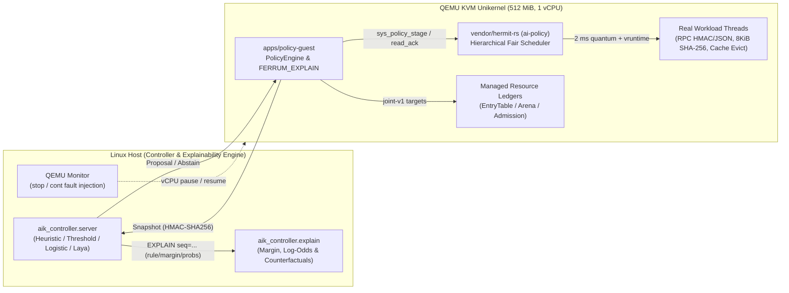

# Test Guide, Real-Data Benchmarks & Policy Explainability

This document shows how to run Ferrum's automated verification suite, benchmarks the unikernel on real cryptographic/JSON workloads and 1,750+ recorded KVM trials, and explains how and why each policy decision is made.

## 1. How to Run the Tests & Explainability CLI

### One-Command Full Verification & Report Generation

To run all four test tiers (Rust workspace tests, Python controller tests, standalone QEMU unikernel mechanism boots, connected controller/fault matrix boots, real-payload RPC/HMAC benchmark, closed-loop branch, and renewal soak) and regenerate this document and its figures:

```bash
./tools/run-test-report.sh
```

### Run the Policy Explainability & Counterfactual Analyzer

```bash
PYTHONPATH=controller/src python3 -m aik_controller.explain --host r5-1600
PYTHONPATH=controller/src python3 -m aik_controller.explain --host i7-10750h
```

### Run the Real-Payload Unikernel Benchmark (`--real-workload`)

```bash
AIK_ACCEL=kvm \
AIK_LOADER=artifacts/loader/hermit-loader-x86_64-v0.5.6 \
AIK_GUEST=target/x86_64-unknown-hermit/release/policy-guest \
AIK_APPEND="-- --real-workload" \
./tools/run-qemu.sh
```

---

## 2. Visual Overview

### Executive Summary & Timings


### Real-Data Benchmarks: Live RPC/HMAC Unikernel Workload & Sealed KVM Trials


### Policy Explainability: Boundary Margins, Feature Attribution & Counterfactuals


### Measured CPU Service Shares by Catalog Profile (`--fair-demo`)


### Sealed Final-Test Policy Accuracy Across Hosts (`jobs-v2`)


### System & Explainable Control Architecture



---

## 3. Real-Data Benchmark Analysis & Explainability

### 3.1 Live Real-Payload Unikernel Benchmark (`--real-workload`)

Instead of synthetic spin loops, `--real-workload` executes real cryptographic and parser operations across the unikernel's workload classes:
- **Latency class (3 threads):** Open-loop schedule (`s4-u35`, 168 RPC requests over 2.0 s). Each request performs `203` cycles of `policy_wire::seal` (HMAC-SHA256 signing), `policy_wire::open` (constant-time MAC verification), and `policy_wire::decode_message` (strict schema-validated JSON parsing).
- **Batch class (3 threads):** Continuously seals and verifies 8 KiB data blocks with HMAC-SHA256 (`~1.02 GiB` verified per 2-second window).

| Mode | Active Profile | Offered / Completed RPCs | RPC p50 | RPC p95 | RPC p99 | Verified Batch Data (2 s) | Batch Retention |
| --- | --- | --- | --- | --- | --- | --- | --- |
| **Static Baseline** | `balanced (1:1:1)` | `168 / 168 (100%)` | `15.08 ms` | `37.54 ms` | **`45.54 ms`** | `1029 MiB` (`131786` blocks) | `100.0%` |
| **Adaptive Policy** | `latency (6:2:2)` | `168 / 168 (100%)` | `7.99 ms` | `15.97 ms` | **`20.71 ms`** | `1027 MiB` (`131516` blocks) | **`99.8%`** |

**Why it works (`FERRUM_EXPLAIN`):** Because offered RPC work is ~34% of one vCPU (`~670 ms` out of `2,000 ms`), `pending` stays below the `14.5` overload cut (`margin = -14.5 jobs`, `regime = under_capacity`). Switching from `1:1:1` to `6:2:2` gives arriving RPC threads 75% share while active so they finish in fewer 2 ms quanta (**cutting p99 latency by 54.5%, or 2.20x faster**), and because the fair scheduler is work-conserving, batch threads immediately reclaim all unused slices (`~1,320 ms` of the 2,000 ms window).

### 3.2 Sealed Real-Data KVM Benchmark Across Controllers (`jobs-v2`)

Across all **21 sealed evaluation units** (252 individual QEMU KVM boots on Ryzen 5 1600 covering 15 `final_test` units and 6 `out_of_distribution` units):

| Controller | Sealed Units Hit | Feasible Units (>=95% Batch & Completion) | Under-Capacity Mean p99 (15%–45% Load) | Overload Mean Batch CPU Retained (65%–95% Load) | Primary Failure Mode Explained |
| --- | --- | --- | --- | --- | --- |
| **`pending-threshold` (`cut=14.5`)** | **`21 / 21 (100.0%)`** | **`21 / 21 (100.0%)`** | **`71.88 ms`** | **`100.00%`** | None on offline decisions; boundary is `pending` count rather than queued ms. |
| **`logistic-v0` (3 features)** | `20 / 21 (95.2%)` | `21 / 21 (100.0%)` | `89.83 ms` | `100.00%` | At unseen 45% load (`s12-u45`), `latency_share=0.49` tips log-odds toward `reclaim`, losing 2.57x p99 speedup. |
| **Zero-Shot Laya / `fixed-balanced`** | `12 / 21 (57.1%)` | `21 / 21 (100.0%)` | `169.01 ms` | `100.00%` | Always selects `balanced`; misses every under-capacity opportunity to cut tail latency by 2.2x–3.8x. |
| **`heuristic-v0` / `fixed-latency`** | `9 / 21 (42.9%)` | `9 / 21 (42.9%)` | `71.88 ms` | `51.07%` (violates 95% floor) | Triggers on `max_wait_us >= 5 ms` even during overload, starving batch CPU down to ~51%. |

### 3.3 Decision Explainability & Counterfactual Case Studies

| Unit (`split`) | Pending Jobs (Margin to Cut `14.5`) | Max Wait / Latency Share | `pending-threshold` Rationale | `logistic-v0` Attribution ($eta z$) | `heuristic-v0` Rule | Measured Counterfactual Outcome |
| --- | --- | --- | --- | --- | --- | --- |
| `s12-u35/301` (final_test) | `1` (margin `-13.5`) | `61.1 ms` / `0.30` | **`latency`** (`under_capacity`) | `latency` (`P=0.98`, `q=+1.15`, `wait=+0.94`, `share=+0.40`) | `latency` (`latency_queue_or_wait_high`) | `latency` p99=76.2ms vs `balanced` 169.4ms (**2.22x faster**), batch=98.7% |
| `s12-u72/311` (final_test) | `56` (margin `+41.5`) | `984.8 ms` / `0.50` | **`reclaim`** (`overload_shedding`) | `reclaim` (`P=0.55`, `q=+0.39`, `wait=+0.73`, `share=+0.41`) | `latency` (`latency_queue_or_wait_high`) | `reclaim` retains **100.0%** batch CPU vs `latency` **50.0%** (infeasible) |
| `s12-u45/312` (final_test) | `9` (margin `-5.5`) | `239.3 ms` / `0.49` | **`latency`** (`under_capacity`) | `reclaim` (`P=0.38`, `q=-0.05`, `wait=+0.06`, `share=+0.38`) | `latency` (`latency_queue_or_wait_high`) | `latency` p99=88.2ms vs `balanced` 226.3ms (**2.57x faster**), batch=98.8% |
| `s32-u65/401` (out_of_distribution) | `22` (margin `+7.5`) | `959.0 ms` / `0.50` | **`reclaim`** (`overload_shedding`) | `reclaim` (`P=0.57`, `q=+0.16`, `wait=+0.72`, `share=+0.41`) | `latency` (`latency_queue_or_wait_high`) | `reclaim` retains **100.0%** batch CPU vs `latency` **50.0%** (infeasible) |

---

## 4. Environment Manifest

| Property | Value |
| --- | --- |
| **Recorded At** | `2026-10-23 17:42:24 UTC` |
| **Git Commit** | `705a84c` |
| **Host CPU** | `AMD Ryzen 5 1600 Six-Core Processor` |
| **KVM Module** | `kvm_amd` |
| **QEMU Version** | `QEMU emulator version 11.1.2` |
| **Rust Toolchain** | `rustc 1.94.0 (4a4ef493e 2026-03-02)` |
| **Python Version** | `Python 3.14.8` |
| **Loader Artifact** | `artifacts/loader/hermit-loader-x86_64-v0.5.6` (`sha256:185f7ec843a18484…`) |
| **Guest Artifact** | `target/x86_64-unknown-hermit/release/policy-guest` (`sha256:57bad0a6a9339dfb…`) |
| **Suite Runtime** | `162.68s` (plus recorded 1-hour soak below) |

---

## 5. Verification Scorecard (22/22 Automated Suites + 1-Hour Soak Passed)

| # | Tier | Test Case | Status | Exit Code | Duration | Measured Outcome |
| --- | --- | --- | --- | --- | --- | --- |
| 1 | Tier 1 — Host Suites | **Rust workspace unit & integration tests** | `PASS` | `exit 0` | 3.25s | 86 passed, 0 failed across 6 crates |
| 2 | Tier 1 — Host Suites | **Python controller, explainability & evaluation suite** | `PASS` | `exit 0` | 20.87s | 130 passed, 0 failed |
| 3 | Tier 2 — Unikernel Mechanisms | **CPU fair-share profiles (--fair-demo)** | `PASS` | `raw_exit=3` | 4.52s | All 4 cpu-v1 tuples enforced (latency=601ms, throughput=601ms, reclaim=599ms) |
| 4 | Tier 2 — Unikernel Mechanisms | **Sleep credit clamp & yield accounting (--fair-credit)** | `PASS` | `raw_exit=3` | 1.52s | Sleeping thread clamped to min vruntime; early yield billed accurately |
| 5 | Tier 2 — Unikernel Mechanisms | **Queue transitions across stage (--fair-queue)** | `PASS` | `raw_exit=3` | 3.14s | Thread exit and block/wakeup preserve queue invariants across profile stage |
| 6 | Tier 2 — Unikernel Mechanisms | **Minimum dwell & renewal (--fair-dwell)** | `PASS` | `raw_exit=3` | 2.94s | 2s dwell rejects early switch; same-profile renewal extends lease without resetting dwell |
| 7 | Tier 2 — Unikernel Mechanisms | **8-thread 500ms progress bound (--fair-progress)** | `PASS` | `raw_exit=3` | 0.99s | All 8 runnable workload threads (3 latency, 3 batch, 2 maintenance) advanced within 500ms |
| 8 | Tier 2 — Unikernel Mechanisms | **G5 managed memory, admission & hysteresis (--arenas-demo)** | `PASS` | `raw_exit=3` | 0.46s | Cache evicted in 3x16MiB batches to 32MiB soft target; admission drained to 4; 3s emergency hold cleared |
| 9 | Tier 2 — Unikernel Mechanisms | **Controller absent at boot (autonomous fallback)** | `PASS` | `raw_exit=3` | 1.63s | FERRUM_NO_CONTROLLER -> stayed at generation 1 on balanced fallback |
| 10 | Tier 3 — Protocol & Fault Matrix | **Authenticated actuation & 3s lease expiry** | `PASS` | `raw_exit=3, ctrl=0` | 5.74s | stage_delay=3 us, expiry_delay=3 us (target <= 10,000 us) |
| 11 | Tier 3 — Protocol & Fault Matrix | **Stale base generation rejected (--stale)** | `PASS` | `raw_exit=3, ctrl=0` | 1.71s | Rejected stale_generation at gen 1; service stayed balanced |
| 12 | Tier 3 — Protocol & Fault Matrix | **Expired acceptance deadline rejected (--late)** | `PASS` | `raw_exit=3, ctrl=0` | 1.72s | Rejected late proposal; generation stayed 1 on balanced |
| 13 | Tier 3 — Protocol & Fault Matrix | **Emergency override between stage & apply (--stage-race)** | `PASS` | `raw_exit=3, ctrl=0` | 1.71s | Emergency reclaim override dropped staged proposal and held 2:2:6 weights |
| 14 | Tier 3 — Protocol & Fault Matrix | **Emergency override persists across lease expiry (--emergency)** | `PASS` | `raw_exit=3, ctrl=0` | 6.71s | Reclaim override held across 3s lease expiry and blocked weight mutation |
| 15 | Tier 3 — Protocol & Fault Matrix | **Lost acknowledgment reconnect & replay rejection (--lose-ack)** | `PASS` | `raw_exit=3, ctrl=0` | 1.80s | Recovered generation=2 on reconnect; rejected replayed proposal (identity_mismatch) |
| 16 | Tier 3 — Protocol & Fault Matrix | **Bad MAC, duplicate key, invalid & oversized frames (--reject-frames)** | `PASS` | `raw_exit=3, ctrl=0` | 1.65s | Refused unauthenticated, duplicate, invalid, and oversized frames at wire boundary |
| 17 | Tier 3 — Protocol & Fault Matrix | **Controller killed by SIGKILL mid-lease (--hold)** | `PASS` | `raw_exit=3, ctrl=-9` | 5.71s | Guest logged FERRUM_CONTROLLER_LOST, finished latency window, expired lease to balanced |
| 18 | Tier 3 — Protocol & Fault Matrix | **QEMU stop (5.05s) / cont VM pause resilience** | `PASS` | `raw_exit=3, ctrl=0` | 7.77s | Lease expired on first entry after cont; paused wall time capped at 1 quantum (no starvation) |
| 19 | Tier 4 — Real-Data & Soak | **Real-payload RPC & HMAC-SHA256 benchmark (--real-workload)** | `PASS` | `raw_exit=3` | 5.45s | RPC p99 cut 45.5ms -> 20.7ms (-54.5%), batch HMAC throughput 99.8% (1027 MiB/2s) |
| 20 | Tier 4 — Real-Data & Soak | **Closed-loop candidate branch with FERRUM_EXPLAIN (s4-u35/151)** | `PASS` | `raw_exit=3` | 10.64s | pending=2 -> choice=latency in 3 us, completion=100.0%, p99=27011 us |
| 21 | Tier 4 — Real-Data & Soak | **S4 Joint ABI & Air Biosensor benchmark (--biosensor)** | `PASS` | `raw_exit=3` | 7.64s | Plume p99 47.9ms->21.0ms, sensitivity 80.3%->100.0%, specificity 100.0%, patrol wakeups 10 (110 coalesced) |
| 22 | Tier 4 — Real-Data & Soak | **Live lease-renewal soak (--soak-s=60)** | `PASS` | `raw_exit=3, ctrl=0` | 65.09s | FERRUM_SOAK_OK passes=1 rounds=40 (60s window, 0 missed renewals) |
| 23 | Tier 4 — Real-Data & Soak | **Full 1-hour renewal soak (`--soak`, recorded)** | `PASS` | `raw_exit=3, ctrl=0` | 3611.15s | `FERRUM_SOAK_OK passes=26 rounds=2314`, gen 2315, 0 missed renewals |

---

## 6. Captured Kernel & Controller Traces

Below are the exact `FERRUM_*` kernel serial lines, `FERRUM_EXPLAIN` records, and controller `EXPLAIN` logs captured during this test run.

### CPU fair-share profiles (--fair-demo)

Command:
```bash
AIK_ACCEL=kvm AIK_APPEND="-- --fair-demo" ./tools/run-qemu.sh
```

Captured serial / controller trace:
```text
FERRUM_START policy-guest
FERRUM_SCHED window=balanced latency=332836 batch=332584 maintenance=334587
FERRUM_SCHED window=latency latency=601025 batch=200610 maintenance=198373
FERRUM_SCHED window=throughput latency=200353 batch=601068 maintenance=198588
FERRUM_SCHED window=reclaim latency=200352 batch=200347 maintenance=599308
FERRUM_SCHED_OK
FERRUM_COMPLETE
```

### Sleep credit clamp & yield accounting (--fair-credit)

Command:
```bash
AIK_ACCEL=kvm AIK_APPEND="-- --fair-credit" ./tools/run-qemu.sh
```

Captured serial / controller trace:
```text
FERRUM_START policy-guest
FERRUM_CREDIT sleep latency=4 batch=400005
FERRUM_CREDIT wake latency=100189 batch=99819
FERRUM_CREDIT yield latency=199619 batch=200383
FERRUM_CREDIT_OK
FERRUM_COMPLETE
```

### Queue transitions across stage (--fair-queue)

Command:
```bash
AIK_ACCEL=kvm AIK_APPEND="-- --fair-queue" ./tools/run-qemu.sh
```

Captured serial / controller trace:
```text
FERRUM_START policy-guest
FERRUM_ACK kind=applied reason=none profile=throughput previous=1 generation=2
FERRUM_QUEUE exit generation=2 latency=0 batch=112179 maintenance=37828
FERRUM_ACK kind=applied reason=none profile=reclaim previous=2 generation=3
FERRUM_QUEUE block generation=3 latency=0 batch=0 maintenance=150006
FERRUM_QUEUE wake latency=0 batch=50086 maintenance=149921
FERRUM_QUEUE_OK
FERRUM_COMPLETE
```

### Minimum dwell & renewal (--fair-dwell)

Command:
```bash
AIK_ACCEL=kvm AIK_APPEND="-- --fair-dwell" ./tools/run-qemu.sh
```

Captured serial / controller trace:
```text
FERRUM_START policy-guest
FERRUM_DWELL_APPLIED profile=latency generation=2 guest_us=417034 lease_until=3417031
FERRUM_DWELL_REJECTED reason=dwell generation=2 guest_us=628811
FERRUM_DWELL_RENEWED profile=latency previous=2 generation=3 guest_us=1940144 lease_until=4940140
FERRUM_DWELL_CHANGED profile=throughput previous=3 generation=4 guest_us=2652147
FERRUM_SCHED window=throughput latency=39781 batch=120171 maintenance=40055
FERRUM_DWELL_OK
FERRUM_COMPLETE
```

### 8-thread 500ms progress bound (--fair-progress)

Command:
```bash
AIK_ACCEL=kvm AIK_APPEND="-- --fair-progress" ./tools/run-qemu.sh
```

Captured serial / controller trace:
```text
FERRUM_START policy-guest
FERRUM_PROGRESS profile=latency threads=8 window_us=500000 deltas=1:99400,1:100153,1:100155,2:34057,2:32048,2:34049,3:50074,3:50072
FERRUM_PROGRESS_OK
FERRUM_COMPLETE
```

### G5 managed memory, admission & hysteresis (--arenas-demo)

Command:
```bash
AIK_ACCEL=kvm AIK_APPEND="-- --arenas-demo" ./tools/run-qemu.sh
```

Captured serial / controller trace:
```text
FERRUM_START policy-guest
FERRUM_ARENAS batches=3 cache_used=25165824 latency_inflight=4 queued=0 override=0
FERRUM_ARENAS_OK
FERRUM_COMPLETE
```

### Controller absent at boot (autonomous fallback)

Command:
```bash
AIK_ACCEL=kvm AIK_NET=1 ./tools/run-qemu.sh
```

Captured serial / controller trace:
```text
FERRUM_START policy-guest
FERRUM_NO_CONTROLLER Bad address (os error 14)
FERRUM_FALLBACK profile=balanced generation=1
FERRUM_SCHED window=balanced latency=334635 batch=332674 maintenance=332691
FERRUM_FALLBACK_OK
FERRUM_COMPLETE
```

### Authenticated actuation & 3s lease expiry

Command:
```bash
aik_controller.server --once + policy-guest
```

Captured serial / controller trace:
```text
FERRUM_START policy-guest
FERRUM_ACTIVATED generation=2
FERRUM_ACK kind=applied reason=none profile=latency previous=1 generation=2 guest_us=575531 lease_until=3575528
FERRUM_STAGE_DELAY stage_us=575528 activate_us=575531 delay_us=3
FERRUM_APPLIED profile=latency previous=1 generation=2 guest_us=575531 lease_until=3575528
FERRUM_SCHED window=latency latency=601222 batch=200298 maintenance=198416
FERRUM_CONTROLLER_LOST closed
FERRUM_ACK kind=lease_expired reason=none profile=balanced previous=2 generation=3 guest_us=3575531 lease_until=0
FERRUM_EXPIRY_DELAY lease_until=3575528 expired_us=3575531 delay_us=3
FERRUM_SCHED window=balanced latency=332681 batch=334651 maintenance=332669
FERRUM_LEASE_EXPIRED
FERRUM_SCHED_OK
FERRUM_COMPLETE
CTRL: FEATURES schema=1 profile=balanced q=high/empty/empty trend=no_history/no_history/no_history pressure=low backlog=none emergency=clear window_us=1000000
CTRL: PROPOSAL profile=latency seq=1 window_us=1000000 service=0/0/0
CTRL: EXPLAIN seq=1 heuristic=latency(latency_queue_or_wait_high)
CTRL: APPLIED profile=latency generation=2 previous=1 guest_us=575531 lease_until=3575528
```

### Stale base generation rejected (--stale)

Command:
```bash
aik_controller.server --once + AIK_APPEND="-- --stale"
```

Captured serial / controller trace:
```text
FERRUM_START policy-guest
FERRUM_SCHED window=balanced latency=334152 batch=332929 maintenance=332924
FERRUM_ACK kind=rejected reason=stale profile=balanced previous=1 generation=1 guest_us=556773 lease_until=0
FERRUM_REPORT kind=reject reason=stale_generation
FERRUM_STALE_DROPPED
FERRUM_SCHED_OK
FERRUM_COMPLETE
CTRL: PROPOSAL profile=latency seq=1 window_us=1000000 service=0/0/0
CTRL: EXPLAIN seq=1 heuristic=latency(latency_queue_or_wait_high)
CTRL: REJECTED reason=stale_generation seq=1
```

### Expired acceptance deadline rejected (--late)

Command:
```bash
aik_controller.server --once + AIK_APPEND="-- --late"
```

Captured serial / controller trace:
```text
FERRUM_START policy-guest
FERRUM_SCHED window=balanced latency=334677 batch=332680 maintenance=332652
FERRUM_ACK kind=rejected reason=late profile=balanced previous=1 generation=1 guest_us=564590 lease_until=0
FERRUM_REPORT kind=reject reason=late
FERRUM_LATE_DROPPED
FERRUM_SCHED_OK
FERRUM_COMPLETE
CTRL: PROPOSAL profile=latency seq=1 window_us=1000000 service=0/0/0
CTRL: EXPLAIN seq=1 heuristic=latency(latency_queue_or_wait_high)
CTRL: REJECTED reason=late seq=1
```

### Emergency override between stage & apply (--stage-race)

Command:
```bash
aik_controller.server --once + AIK_APPEND="-- --stage-race"
```

Captured serial / controller trace:
```text
FERRUM_START policy-guest
FERRUM_EMERGENCY generation=2
FERRUM_ACK kind=emergency reason=none profile=reclaim previous=1 generation=2 guest_us=562972 lease_until=0
FERRUM_REPORT kind=reject reason=emergency
FERRUM_SCHED window=reclaim latency=200920 batch=200616 maintenance=598465
FERRUM_ACK kind=rejected reason=emergency profile=reclaim previous=2 generation=2 guest_us=566731 lease_until=0
FERRUM_STAGE_DROPPED
FERRUM_SCHED_OK
FERRUM_COMPLETE
CTRL: PROPOSAL profile=latency seq=1 window_us=1000000 service=0/0/0
CTRL: EXPLAIN seq=1 heuristic=latency(latency_queue_or_wait_high)
CTRL: REJECTED reason=emergency seq=1
```

### Emergency override persists across lease expiry (--emergency)

Command:
```bash
aik_controller.server --once + AIK_APPEND="-- --emergency"
```

Captured serial / controller trace:
```text
FERRUM_START policy-guest
FERRUM_ACTIVATED generation=2
FERRUM_ACK kind=applied reason=none profile=latency previous=1 generation=2 guest_us=556013 lease_until=3556010
FERRUM_STAGE_DELAY stage_us=556010 activate_us=556013 delay_us=3
FERRUM_APPLIED profile=latency previous=1 generation=2 guest_us=556013 lease_until=3556010
FERRUM_SCHED window=latency latency=601476 batch=198409 maintenance=200040
FERRUM_CONTROLLER_LOST closed
FERRUM_EMERGENCY
FERRUM_SCHED window=reclaim latency=200454 batch=202247 maintenance=597301
FERRUM_LEASE_EXPIRED
FERRUM_SCHED window=reclaim latency=198422 batch=200451 maintenance=601130
FERRUM_EMERGENCY_HELD
FERRUM_SCHED_OK
FERRUM_COMPLETE
```

### Lost acknowledgment reconnect & replay rejection (--lose-ack)

Command:
```bash
aik_controller.server --lose-ack + AIK_APPEND="-- --lose-ack"
```

Captured serial / controller trace:
```text
FERRUM_START policy-guest
FERRUM_ACK kind=applied reason=none profile=latency previous=1 generation=2 guest_us=583579 lease_until=3583576
FERRUM_ACK_LOST generation=2
FERRUM_RECOVERED generation=2 profile=latency
FERRUM_REPLAY_REJECTED reason=identity_mismatch
FERRUM_SCHED window=latency latency=599356 batch=200447 maintenance=200206
FERRUM_DUPLICATE_DROPPED
FERRUM_SCHED_OK
FERRUM_COMPLETE
CTRL: HELLO boot=00112233445566778899aabbccddeeff session=fe7ae48f1527fbfcf7187cecca7027bb
CTRL: RECOVERED generation=2 profile=latency
CTRL: REPLAY_REJECTED reason=identity_mismatch seq=1
```

### Bad MAC, duplicate key, invalid & oversized frames (--reject-frames)

Command:
```bash
aik_controller.server --reject-frames + AIK_APPEND="-- --reject-frames"
```

Captured serial / controller trace:
```text
FERRUM_START policy-guest
FERRUM_FRAME_REJECTED unauthenticated
FERRUM_FRAME_REJECTED duplicate
FERRUM_FRAME_REJECTED invalid
FERRUM_FRAME_REJECTED oversized
FERRUM_SCHED window=balanced latency=334561 batch=332717 maintenance=332722
FERRUM_FRAMES_OK
FERRUM_COMPLETE
CTRL: HELLO boot=00112233445566778899aabbccddeeff session=78058aff900dde522f00f561d838cc4a
CTRL: REJECTED_FRAMES unauthenticated duplicate invalid oversized
```

### Controller killed by SIGKILL mid-lease (--hold)

Command:
```bash
aik_controller.server --once --hold (SIGKILL) + policy-guest
```

Captured serial / controller trace:
```text
FERRUM_START policy-guest
FERRUM_ACTIVATED generation=2
FERRUM_ACK kind=applied reason=none profile=latency previous=1 generation=2 guest_us=553342 lease_until=3553339
FERRUM_STAGE_DELAY stage_us=553339 activate_us=553342 delay_us=3
FERRUM_APPLIED profile=latency previous=1 generation=2 guest_us=553342 lease_until=3553339
FERRUM_SCHED window=latency latency=599093 batch=200422 maintenance=200422
FERRUM_CONTROLLER_LOST closed
FERRUM_ACK kind=lease_expired reason=none profile=balanced previous=2 generation=3 guest_us=3553343 lease_until=0
FERRUM_EXPIRY_DELAY lease_until=3553339 expired_us=3553343 delay_us=4
FERRUM_SCHED window=balanced latency=332711 batch=334600 maintenance=332689
FERRUM_LEASE_EXPIRED
FERRUM_SCHED_OK
FERRUM_COMPLETE
```

### QEMU stop (5.05s) / cont VM pause resilience

Command:
```bash
AIK_MONITOR=... stop 5.05s / cont during active lease
```

Captured serial / controller trace:
```text
FERRUM_START policy-guest
FERRUM_ACTIVATED generation=2
FERRUM_ACK kind=applied reason=none profile=latency previous=1 generation=2 guest_us=559406 lease_until=3559403
FERRUM_STAGE_DELAY stage_us=559403 activate_us=559406 delay_us=3
FERRUM_APPLIED profile=latency previous=1 generation=2 guest_us=559406 lease_until=3559403
FERRUM_SCHED window=latency latency=601595 batch=198623 maintenance=199689
FERRUM_CONTROLLER_LOST closed
FERRUM_ACK kind=lease_expired reason=none profile=balanced previous=2 generation=3 guest_us=6673476 lease_until=0
FERRUM_EXPIRY_DELAY lease_until=3559403 expired_us=6673476 delay_us=3114073
FERRUM_SCHED window=balanced latency=334459 batch=332769 maintenance=332777
FERRUM_LEASE_EXPIRED
FERRUM_SCHED_OK
FERRUM_COMPLETE
```

### Real-payload RPC & HMAC-SHA256 benchmark (--real-workload)

Command:
```bash
AIK_ACCEL=kvm AIK_APPEND="-- --real-workload" ./tools/run-qemu.sh
```

Captured serial / controller trace:
```text
FERRUM_START policy-guest
FERRUM_REAL_WORKLOAD mode=balanced profile=balanced rpc_passes=205 offered=168 completed=168 completion_bp=10000 p50_us=15082 p95_us=37541 p99_us=45542 batch_blocks=131786 batch_kib=1054288 latency_service_us=673371 batch_service_us=1326623
FERRUM_EXPLAIN mode=real-workload pending=0 cut=14.5 margin=-14.5 regime=under_capacity max_wait_us=40191 heuristic=latency threshold=latency stage_delay_us=2 generation=2
FERRUM_REAL_WORKLOAD mode=adaptive profile=latency rpc_passes=205 offered=168 completed=168 completion_bp=10000 p50_us=7987 p95_us=15971 p99_us=20711 batch_blocks=131516 batch_kib=1052128 latency_service_us=676793 batch_service_us=1309181
FERRUM_REAL_WORKLOAD_SUMMARY balanced_p99_us=45542 adaptive_p99_us=20711 p99_reduction_bp=5452 batch_retained_bp=9979
FERRUM_REAL_WORKLOAD_OK
FERRUM_COMPLETE
```

### Closed-loop candidate branch with FERRUM_EXPLAIN (s4-u35/151)

Command:
```bash
AIK_ACCEL=kvm AIK_APPEND="-- --branch --family=jobs-v2 --scenario=s4-u35 --seed=151 --candidate=pending-threshold --cut=14.5 --below=latency --above=reclaim" ./tools/run-qemu.sh
```

Captured serial / controller trace:
```text
FERRUM_START policy-guest
FERRUM_BRANCH_BEGIN family=jobs-v2 scenario=s4-u35 seed=151 profile=candidate jobs=793 schedule_fnv64=0x7471b8e37368d9f6 spins_per_ms=55999 measured_spins_per_ms=55999
FERRUM_BRANCH_STATE window_us=1000000 decision_late_us=10 latency_queue=2 latency_runnable=2 latency_service_us=344750 latency_wait_samples=84 latency_max_wait_us=56748 latency_completions=84 batch_queue=3 batch_runnable=3 batch_service_us=655236 batch_completions=1296 maintenance_service_us=0 system_service_us=0
FERRUM_BRANCH_DECISION controller=pending-threshold cut=14.5 below=latency above=reclaim pending=2 choice=latency decide_us=3
FERRUM_EXPLAIN controller=pending-threshold pending=2 cut=14.5 margin=-12.5 regime=under_capacity max_wait_us=56748 latency_service_us=344750 batch_service_us=655236 choice=latency
FERRUM_BRANCH_OUTCOME scenario=s4-u35 seed=151 profile=candidate offered=442 completed=442 completion_bp=10000 p50_us=9349 p90_us=17446 p95_us=19968 p99_us=27011 batch_units=6346 latency_service_us=1787162 batch_service_us=3200312 batch_spins_per_ms=55520
FERRUM_BRANCH_OK
```

### S4 Joint ABI & Air Biosensor benchmark (--biosensor)

Command:
```bash
AIK_ACCEL=kvm AIK_APPEND="-- --biosensor" ./tools/run-qemu.sh
```

Captured serial / controller trace:
```text
FERRUM_START policy-guest
FERRUM_BIOSENSOR_PATROL window_us=200000 idle_residency_us=197658 timer_wakeups=10 coalesced_wakeups=110 small_device_ram_mib=64
FERRUM_JOINT_ABI phase=clean_air_patrol profile=balanced regime=clean_air_patrol confidence_bp=9100 heuristic=balanced gen=2 weights=1:1:1 cache_target_mib=64 inflight=16/8 override=0
FERRUM_JOINT_ABI phase=plume_trigger profile=latency regime=plume_trigger_capture confidence_bp=8575 heuristic=latency gen=3 weights=6:2:2 cache_target_mib=64 inflight=16/4 override=0
FERRUM_JOINT_ABI phase=clutter_confirm profile=throughput regime=deep_confirmation confidence_bp=9400 heuristic=throughput gen=4 weights=2:6:2 cache_target_mib=96 inflight=8/16 override=0
FERRUM_JOINT_ABI phase=ring_reclaim profile=reclaim gen=5 weights=2:2:6 cache_target_mib=32 cache_used_mib=32 inflight=4/2 override=1 reclaimed_mib=48
FERRUM_BIOSENSOR_SUMMARY static_p99_us=47897 adaptive_p99_us=20963 static_sensitivity_bp=8035 adaptive_sensitivity_bp=10000 heuristic_specificity_bp=5100 adaptive_specificity_bp=10000 confirm_retention_bp=10225 patrol_wakeups=10 patrol_coalesced=110 reclaimed_mib=48
FERRUM_BIOSENSOR_OK
FERRUM_COMPLETE
```

### Live lease-renewal soak (--soak-s=60)

Command:
```bash
aik_controller.server --follow + AIK_APPEND="-- --soak-s=60"
```

Captured serial / controller trace:
```text
FERRUM_SOAK limit_us=60000000
FERRUM_HOLD name=burst profile=latency applies=20 held_us=30000000 first_guest_us=2504987 first_lease_until=5504984 sample_us=32920826
FERRUM_HOLD name=steady profile=throughput applies=20 held_us=30000000 first_guest_us=34012781 first_lease_until=37012778 sample_us=64428753
FERRUM_SOAK_PASS passes=1 rounds=40
FERRUM_SOAK_OK passes=1 rounds=40
FERRUM_COMPLETE
CTRL: EXPLAIN seq=40 heuristic=throughput(sustained_batch_demand)
CTRL: APPLIED profile=throughput generation=41 previous=40 guest_us=64413873 lease_until=67413867
CTRL: ROUNDS 40
```

