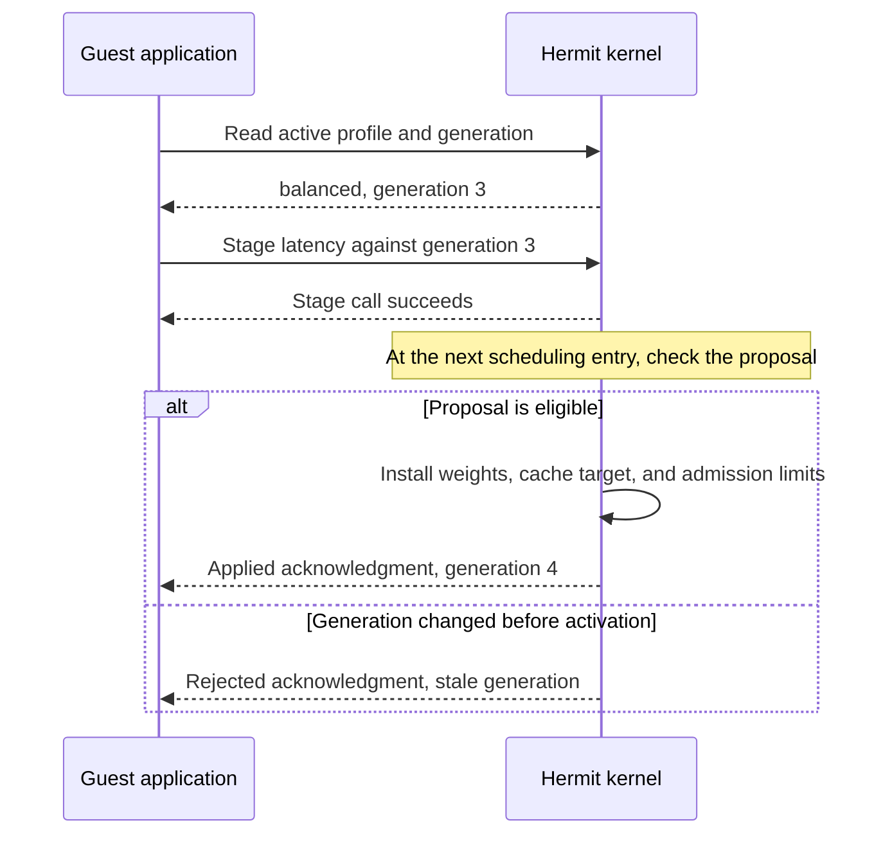

# Advanced · Trace a policy through Hermit

The heuristic has chosen `latency` twice. The application still needs to find out whether Hermit installed it. That handoff uses an application binary interface (ABI), a shared memory layout and calling convention. The guest fills an `AbiStageJointIn` with the profile settings and the generation it observed. A **generation** identifies a revision of the active policy. It lets Hermit detect a proposal built against an older revision. [ABI structures](../../../crates/hermit-policy-abi/src/lib.rs) · [Guest staging code](../../../deployments/air-biosensor/src/autonomous.rs)



Staging queues a proposal. At activation, Hermit checks the emergency override, base generation, acceptance deadline, and dwell interval. For an eligible `latency` proposal, it installs weights of 6, 2, and 2, a 64 MiB cache soft target, and limits of 16 in-flight latency jobs and 4 batch jobs. The guest checks the applied acknowledgment against the requested profile and expected generation. It can also confirm activation by reading kernel status. [Profile values](../../../configs/catalog-joint-v1.json) · [Kernel activation and lease enforcement](../../../vendor/hermit-rs/kernel/src/policy.rs)

## Reason about the three timers

| Timer in this offline guest | What it governs |
| --- | --- |
| 750 ms acceptance window | The scheduler drops a proposal if it reaches activation after the deadline set at staging. |
| 2 s minimum dwell | After a profile change, another change must wait. Renewing the installed settings can proceed during dwell. |
| 3 s lease | Staging sets the proposed expiry. Acceptance installs it. If the lease expires, Hermit restores `balanced` unless an emergency override is active. |

**Exercise.** Suppose Hermit changes to `latency` at 2.0 s and accepts a renewal at 2.5 s. When can it next change profiles, assuming the generation and other checks pass? At 4.0 s. The renewal advances the generation and extends the lease. The dwell clock still runs from the change at 2.0 s. Run the host policy model test from the repository root to check this invariant. [Timing constants](../../../crates/policy-types/src/lib.rs) · [Model and test](../../../crates/policy-core/src/engine.rs)

```bash
cargo test -p policy-core dwell_allows_renewal_without_restarting_the_change_timer
```

## Interpret a guest trace

One of the updated one-cycle boots produced these two lines during capture.

```text
FERRUM_LOCAL_DECISION phase=capture choice=latency rule=latency_queue_or_wait_high regime=normal action=stability-deferred streak=1
FERRUM_LOCAL_ACK phase=capture profile=latency generation=4 activation_us=144 lease_until=7764453 rule=latency_queue_or_wait_high regime=normal
```

The first line records a candidate. The second confirms installation after the next qualifying sample. Here `activation_us=144` measures the guest’s wait from staging through confirmation. The same boot’s summary reported `capture_policy_activation_us=2000803`, about two seconds from phase entry through confirmation. Neither timestamp measures completion of a sensor capture. To collect your own trace, follow the offline boot recipe and read the `FERRUM_LOCAL_DECISION`, `FERRUM_LOCAL_ACK`, and `FERRUM_AUTONOMOUS_SUMMARY` lines in order. [Offline boot recipe](../../16-autonomous-policy-engine.md#build-and-run-without-networking)

[Previous lesson · Read a telemetry window](../intermediate/README.md) · [Return to the test results](../../../README.md#offline-air-biosensor-test-results)
