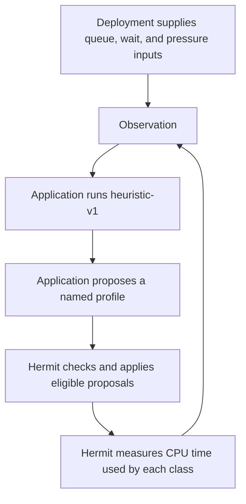

# Basic · Follow a policy decision

During patrol, the air-biosensor demo has little work queued. During confirmation, ten batch jobs are waiting. Both phases run the same application. What changes is how the kernel shares resources among the jobs.

Ferrum groups work into three classes. The **latency** class handles work sensitive to delay, **batch** handles queued processing, and **maintenance** handles upkeep. A **profile** gives the three classes relative CPU weights and sets a cache target and limits on in-flight work. For example, `throughput` gives batch a weight of 6 while latency and maintenance each get 2. These weights matter when classes compete for CPU time. [Joint profile catalog](../../../configs/catalog-joint-v1.json)



The diagram follows the offline **guest**, where the application and Hermit kernel run together in a virtual machine. The application chooses a profile, and Hermit controls the resources. An optional host controller can supply proposals in connected experiments. Both paths use the same joint policy interface.

## Run the host demo

From the repository root on a machine with Rust and Cargo, run the following command. It supplies simulated CPU values and prints the local policy plan. This exercise works without QEMU or a sensor.

```bash
cargo run -p air-biosensor -- --autonomous
```

Read the `phase` and `profile` fields on the five `FERRUM_LOCAL_PLAN` lines.

| Simulated phase | Host plan | What the rule sees |
| --- | --- | --- |
| `patrol` | `balanced` | Empty queues and low memory pressure |
| `capture` | `latency` | Eight latency jobs queued and an 18 ms sampled wait |
| `confirmation` | `throughput` | Ten batch jobs queued and an empty latency queue |
| `recovery` | `balanced` | Queues have drained |
| `pressure_reclaim` | `reclaim` | High managed-memory use and a 64 MiB evictable backlog |

**Check your reading.** Both `capture` and `pressure_reclaim` have waiting latency jobs. Why do they choose different profiles? The heuristic checks memory pressure first. In the final phase that rule chooses `reclaim` before queue length can select `latency`. The host trace labels its CPU inputs `simulated` and the kernel `unavailable`. To see which profile Hermit actually applied, read the guest acknowledgments in the advanced lesson. [Phase definitions](../../../deployments/air-biosensor/src/lib.rs) · [Heuristic rules](../../../crates/policy-core/src/heuristic.rs)

[Next lesson · Read a telemetry window](../intermediate/README.md)
