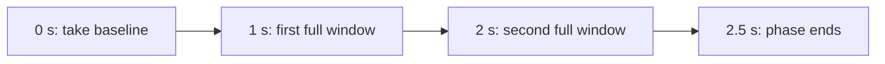

# Intermediate · Read a telemetry window

Why did the host plan choose `latency` for capture while one of the updated guest boots stayed on `balanced`? The host uses fixed simulated CPU values. The guest measures how much CPU time each class actually received, and the shared heuristic uses those measurements to decide whether boosting latency would take too much service away from batch.

## Turn cumulative time into a measurement

Each Hermit counter accumulates microseconds of CPU service for one class. Suppose the latency counter reads 4,100,000 µs at phase entry and 4,700,000 µs one second later. The class received 600,000 µs of service in that window, or 60% of one vCPU. The guest uses the elapsed time between the readings as the denominator. [Guest sampler and window checks](../../../deployments/air-biosensor/src/autonomous.rs)



An ordinary change needs the same candidate in two consecutive valid samples within the phase. If the read at one second fails, the read at two seconds becomes the next baseline. Using the phase-entry counter with a one-second denominator would count two seconds of work in one window. Counter resets and stale windows also interrupt the pending choice. The half-second at the end cannot supply another full sample. A pressure-driven `reclaim` choice bypasses the two-sample filter but still goes through dwell and kernel validation.

## Work through an overload decision

Assume a one-second window, a `balanced` profile, and only latency and batch active. Their equal weights give each a reference share of 500,000 µs. Suppose latency gets 600,000 µs, batch gets 400,000 µs, and latency has jobs waiting. The heuristic represents ratios in basis points, with 10,000 basis points equal to 100%.

| Signal | Calculation | Result |
| --- | --- | ---: |
| CPU busy | (600,000 + 400,000) / 1,000,000 | 100% |
| Latency service relative to its reference share | 600,000 / 500,000 | 120% |
| Batch service retained relative to its reference share | 400,000 / 500,000 | 80% |

Batch is active, the CPU exceeds the 95% contention threshold, latency already exceeds its reference share, and batch is below its 95% floor. The `batch_floor` rule therefore selects `balanced` and enters the overload regime. In one recorded capture phase, this happened on the first sample. The second chose `latency`, leaving only one qualifying sample before the phase ended. The arithmetic above is a worked example. The boot trace recorded the rules and choices. [Thresholds](../../../configs/heuristic-v1.json) · [Decision code](../../../crates/policy-core/src/heuristic.rs) · [Boot results](../../16-autonomous-policy-engine.md#current-host-and-known-limits)

## Try the missing-read case

From the repository root, run the host regression test.

```bash
cargo test -p air-biosensor --bin air-biosensor a_missing_endpoint_requires_a_fresh_baseline
```

Look for one passing test. It checks that both windows touching a missing read are incomplete. The next pair of successful readings yields service deltas of 100, 45, and 0 µs across the three classes, over 1,000,125 µs of elapsed time.

[Previous lesson · Follow a policy decision](../basic/README.md) · [Next lesson · Trace a policy through Hermit](../advanced/README.md)
